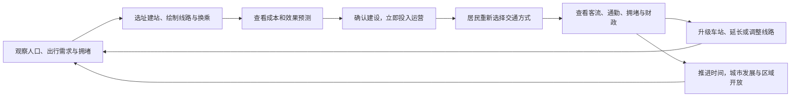

# 《城市与地铁》产品需求文档（PRD）V1.1

| 项目 | 内容 |
| --- | --- |
| 产品名称 | 城市与地铁 |
| 文档版本 | V1.1 |
| 编写日期 | 2026-10-16 |
| 更新日期 | 2026-10-17 |
| 文档状态 | 已按当前实现同步的需求与验收基线；验收结果另行记录 |
| 对应游戏版本 | v1.3.0；存档格式版本 2 |
| 产品形态 | 单人网页模拟经营游戏，电脑浏览器优先 |
| 首版场景 | 从 1990 年广州开始，随时间持续发展 |
| 需求来源 | [《城市与地铁》网页游戏需求说明（ChatGPT 分享页）](https://chatgpt.com/s/t_6ad1db6046448191834fda44f6162528)、用户已确认的体验优化、当前工作区实现及地图设计指南 |
| 当前产品范围 | 已有广州地图游戏的需求同步与后续验收；其他城市与独立教程地图属于后续扩展 |

## 1. 文档说明

本文保留 V1.0 的核心玩法和范围，补入用户已确认的功能优化，并按当前工作区游戏 v1.3.0 的代码同步布局、操作、规则和默认参数。分享页中的图片参考和界面示意用于说明风格，不视为最终美术资产或定稿界面。

本文使用以下约定：

- **来源需求**：原文及用户后续明确提出的产品方向、功能和范围，正文功能描述以此为基础。
- **已确认优化**：用户明确同意纳入的统一票价、规模卡片、延长与支线入口、拥挤诊断、搜索收藏、批量修改、拆除预览和线路示意图。
- **当前实现 / 当前默认值**：已核对代码的行为和可调整参数，用于现有版本迭代；不等同于史实、现实工程标准或已通过测试的结论。代码与 README 描述不一致时，本次同步以代码为准。
- **设计补充**：为让流程完整、行为可验证而补充的产品要求；尚未核实的实现不记为完成。
- **验收要求**：第 12 节是测试和发布的依据，本次文档同步不代表这些场景已经实测通过。性能及历史准确性仍需专项验证。

文档版本与游戏版本分别管理。本次同步 PRD 与地图设计指南，不修改游戏代码。当前为可直接打开 index.html 的 HTML/CSS/JavaScript 单机网页游戏，无需账号或本地服务器；地图和程序资源随项目提供。后续扩展地图遵循[地图设计指南](./地图设计指南.md)。

## 2. 产品定位与目标

### 2.1 产品概述

《城市与地铁》是一款以地铁规划为核心的单人网页模拟经营游戏。玩家在不断发展的城市中选址建站、绘制线路、规划换乘，并通过交通数据观察自己的规划如何影响居民出行、道路拥堵和城市发展。

玩家负责地铁网络的规划、建设与票价决策；系统负责道路及城市发展、居民出行选择和列车日常运营。

### 2.2 核心价值

1. **规划自由**：车站和线路可自由布局，同时受到地形、成本和保护建筑等现实条件约束。
2. **反馈可信**：居民根据出行便利性选择交通方式，地铁建设的收益通过客流、通勤和道路拥堵变化体现。
3. **城市持续变化**：城市既参考历史演变，也响应玩家建设的地铁网络，推动玩家不断调整规划。
4. **决策有依据**：以分析图层、建设前预测和运营后数据支持规划判断。
5. **玩法可选择**：兼顾无限资金的自由创造和有限预算下的经营挑战。

### 2.3 目标用户与使用场景

以下用户分类为**设计补充**，用于组织体验，尚未经过用户研究验证。

| 用户类型 | 主要诉求 | 典型场景 |
| --- | --- | --- |
| 地铁及城市交通爱好者 | 自由规划线路，观察网络效果 | 从零建设广州地铁，尝试环线、支线和换乘枢纽 |
| 模拟经营玩家 | 在预算与服务效果之间权衡 | 利用拨款和票款改善交通，应对城市增长 |
| 休闲建造玩家 | 低压力创造并观看城市变化 | 在自由建造模式中持续扩建，切换视角观察城市 |

### 2.4 首版成功标准

首版应形成完整体验：玩家从无地铁的广州起步，完成规划与建设，观察居民出行变化，依据数据继续扩建，并在城市发展后再次调整网络。

验收以玩法闭环和模拟因果关系为主。商业指标、留存目标和固定的拥堵改善百分比未在来源中定义，本文不设定未经确认的数值目标。

## 3. 核心玩法与职责边界

### 3.1 核心循环

### 3.2 玩家与系统分工

| 事项 | 玩家负责 | 系统负责 |
| --- | --- | --- |
| 地铁建设 | 站点位置、规模、线路形态、建设方式（含地铁跨江桥梁与隧道）、改扩建与拆除 | 合法性检查、费用计算、建成后的网络更新 |
| 地铁运营 | 制定票价，查看服务和成本 | 按客流自动调整发车频率、列车数量及运力 |
| 城市交通 | 通过地铁规划改善出行 | 居民出行生成、方式选择、道路交通变化 |
| 城市发展 | 通过地铁可达性产生影响 | 人口、住宅、就业、道路、道路桥梁和新城区发展 |
| 经营挑战 | 安排预算、处理任务与经营压力 | 拨款、票款、费用、任务及失败条件结算 |

## 4. 当前版本产品范围

### 4.1 必须包含的产品能力

| 范围 | 首版要求 | 对应功能 |
| --- | --- | --- |
| 城市场景 | 广州、1990 年无地铁开局，逐步开放区域，持续发展到现代及未来 | CITY-01～03 |
| 地图表现 | 2D 与 2.5D 等距视图、地下视图、动态车流与行人；动画及交互过渡平滑流畅 | VIEW-01～04 |
| 建设系统 | 自由建站和绘线，普通线路、环线、支线，多种建设方式，规模卡片、端点延长、批量修改及拆除影响预览 | BUILD-01～09 |
| 交通模拟 | 汽车与地铁、早晚高峰、道路步行可达性、站内及站外换乘 | SIM-01～04 |
| 自动运营 | 系统调度运力，全网统一票价滑块，运营收支与拥挤原因诊断 | OPS-01～03 |
| 游戏模式 | 自由建造、经营挑战；历史参考任务与动态任务 | MODE-01～03 |
| 数据分析 | 六类分析图层、建设前预测、历史统计和可定位的线路示意图 | DATA-01～04 |
| 时间控制 | 暂停、加速、推进一个月或一年 | TIME-01～02 |
| 进度保存 | 无账号、本地自动和手动存档、多存档、文件导入导出 | SAVE-01～03 |
| 界面操作 | 电脑浏览器、鼠标键盘，地图为主、摘要可展开，搜索收藏、单页设置、工具选项条和草案栏 | UI-01～05 |

表中合并原始需求、用户已确认的优化和当前实现。不得因界面简化删去信息详情、2.5D、环线、支线、效果预测或经营挑战等核心能力。

### 4.2 首版之外

- 其他真实城市及虚构城市。
- 独立新手教程地图。用户已明确本轮不做新手引导，后续单独制作教程地图；普通广州地图不新增强制引导流程。
- 公交系统及独立步行出行方式。当前交通方式为汽车与地铁，步行用于进出站和站外换乘。
- 手机和平板的完整适配。
- 账号注册及登录流程。
- 玩家手动建设道路、道路桥梁或管理城市全部事务；地铁专用跨江桥梁属于首版地铁建设范围。
- 玩家手动编制每辆列车的班次表。

多人联机、云存档、排行榜、付费系统和城市编辑器不纳入本次范围。当前项目支持直接打开本地文件游玩，不承诺托管网页首次离线访问、跨设备同步或浏览器间共享进度。

后续地图制作已有指南，但当前运行入口仍只有广州，尚不具备通用地图包选择及按地图隔离的存档架构。

## 5. 功能需求

### 5.1 城市与历史演进

| 编号 | 功能 | 需求描述 |
| --- | --- | --- |
| CITY-01 | 1990 年广州开局 | 新游戏从 1990 年开始，初始地图没有地铁，仅开放当时主要建成区；道路、珠江、建筑、人口、商业区和历史地标尽可能参考对应时期资料 |
| CITY-02 | 历史与玩家共同驱动发展 | 随时间、人口及城市发展逐步开放更多区域；地铁可达性能够影响住宅、商业活动和区域发展，而非完全固定重演历史 |
| CITY-03 | 系统建设与长期发展 | 道路、道路桥梁和新城区由系统发展；地铁专用跨江桥梁由玩家规划；游戏没有固定结束年份，可继续进入现代及未来 |

业务规则：

- 优先使用真实历史资料；无法获得的数据允许合理估算，必须区分真实资料与估算。
- 玩家可以自由规划自己的网络，原文未要求按广州真实地铁线路和开通年份解锁建设。
- **设计补充**：历史资料记录与模拟规则分开标识；未来年份明确采用模拟发展规则，不呈现为已发生的历史。
- **当前广州样本**：1990-01-01 06:00、无地铁、默认暂停；250 m 格网，120 × 96 格，约 30 km × 24 km；交通小区为 4 × 4 格，约 1 km²。
- 初始地图范围人口约 300 万、岗位约 150 万，属于模拟校准值，不等同于广州市行政区统计。当前有 27 个显式区域及默认外围区域、33 处地标，按区域开放和设施年代演进。
- 当前以 OpenStreetMap 地理骨架配合年代和发展规则构成广州场景，不宣称拥有完整的 1990 年实测底图；人口及界面阶段以 2020 年为历史参考截止，2021 年起标为模拟发展。
- 未来增长采用有上限的估算曲线并受地铁可达性影响；“无固定结束年份”不等于地图、人口或画面实体无限增长。地图数据和新增地图的具体规范见第 8 节。

### 5.2 地图与视觉表现

| 编号 | 功能 | 需求描述 |
| --- | --- | --- |
| VIEW-01 | 2D / 2.5D 切换 | 2D 清楚展示道路、站点、线路、人口和交通，支持精确规划；2.5D 等距视图展示立体建筑、道路、行人、汽车和地铁，体现城市变化 |
| VIEW-02 | 建设方式识别与地下视图 | 线路颜色表示线路归属；地下、地面和高架还需以透明度、虚线、桥墩、阴影及高度等方式区分，详情与工具显示方式文字；地下视图突出地下网络，支持查看和修改 |
| VIEW-03 | 动态城市表现 | 汽车沿道路移动、地铁列车沿线路运行、行人在城市中活动；车辆密度与移动速度随交通状况变化 |
| VIEW-04 | 平滑流畅的动画与过渡 | 用户补充：汽车、列车、行人运动，以及地图操作、视图切换和面板展开收起均需平滑流畅，避免明显卡顿、跳帧、闪烁和突兀跳变 |

视觉原则：现代简约的交通规划界面，结合微缩城市效果；地图占据主要空间，面板尽量减少遮挡。浅色采用浅蓝白底、柔和蓝色水系、浅绿公园和稀疏蓝灰建筑；深色采用深蓝夜景与建筑灯光。山体为青绿色山峰，保留地图边缘雾化与 2.5D 远景薄雾，删除飘云装饰。

**当前地图识别规则**：

- 地下轨道在普通视图中稍淡并带短白虚纹，地面轨道贴地并有白色枕木纹，高架轨道带衬边、抬升、阴影和桥墩；2D 中结合细部线纹、衬边与方式文字识别。地下、地面及草案均可能含白色虚纹，不能用“虚线”作为唯一含义。具体建设适用场景见第 5.3 节。
- 换乘站采用更大的站点圆、深色外环和按线路颜色分段的内环，放大后显示换乘箭头；有效站外换乘用虚线连接两站，并将相应站点标为换乘。地图与线路示意图的标记分别适配各自比例。
- 建站、铺轨、拆除、线路开通、任务完成及资金变化保留短促反馈；取消飘云不等于取消建设反馈。

**设计补充**：两种视图展示同一份城市与交通状态，切换视图不改变模拟结果；画面中的车辆和行人可采用代表性展示，展示数量与模拟人口不必一一对应，但应与交通变化方向一致。

**动画体验要求（用户补充）**：

- 汽车、列车与行人的位置连续变化，转弯、启停和速度变化自然；正常运行时避免瞬移、逐格跳动及沿曲线移动时突然变向。
- 地图平移、缩放、2D / 2.5D 与地下视图切换，以及面板、图层和选中状态的变化应连贯，操作有及时反馈。
- 暂停、恢复和加速时，动态对象的运动与游戏状态一致；加速后仍应保持连续的运动表现。跳月、跳年属于时间跳跃，完成后清楚呈现新状态，无需逐帧播放整个期间。
- 动效简洁克制，不拖慢选址、绘线和查看数据等频繁操作，不因等待过渡完成而阻塞连续输入。
- 在约定设备与目标城市规模下，同时观察车流、运行列车并操作地图或展开面板时，仍应保持整体流畅；验收同时关注连续运动、操作响应和帧间稳定性。
- 尊重系统“减少动态效果”偏好，自动缩短或减少非必要动画；不另设复杂动效配置。设置中的“车辆与行人”统一控制汽车、行人及列车动画显示，关闭不能改变交通模拟结果。
- 当前视觉展示上限为汽车 320、行人 180，采用分块缓存和分帧预算；这些参数属于性能策略，不代表已达到指定帧率或已通过所有规模的流畅性测试。

### 5.3 地铁规划与建设

| 编号 | 功能 | 需求描述 |
| --- | --- | --- |
| BUILD-01 | 自由建站与绘线 | 玩家在地图上选址建站，绘制连接车站的线路；线路无需沿道路，可调整方向、曲线和转弯点 |
| BUILD-02 | 普通线路、环线和支线 | 普通线路连接多个车站；环线形成单一闭环；支线允许从站点分向不同城区，当前按连通树形网络组织；三种形态均参与运营与寻路，环线不再附接同线支线 |
| BUILD-03 | 建设方式与跨江 | 支持地下、地面、高架；跨江可选择桥梁或隧道；不同方式具有不同成本，并受地形、建筑与空间限制 |
| BUILD-04 | 拆迁与保护 | 普通建筑允许付费拆迁；历史建筑和重要地标禁止拆除 |
| BUILD-05 | 车站规模卡片与升级 | 小型 / 中型 / 大型三张卡片显示容量、列车编组上限、建设费和日运营费；既有车站显示升级前后差异及本次费用；批量操作只升级，单站编辑可缩减但不退款 |
| BUILD-06 | 即时建设与网络调整 | 确认后立即建成并投入运营，无施工等待；支持修改和拆除已有线路；小范围调整免费，新站、延长轨道及大规模搬迁收费 |
| BUILD-07 | 延长与支线入口 | 选中普通线或支线后，在选择 / 修改工具显示叶端点“+”手柄，拖动进入延长绘线；车站详情提供所属线路延长及中间站支线入口；环线无端点延长及同线支线入口 |
| BUILD-08 | 批量修改 | 选择 / 修改工具中 Ctrl 或 Shift 多选车站或轨道；车站统一升级，轨道统一变更地下 / 地面 / 高架；预览本次费用、完整草案费用及新增冲突，整批作为一步草案修改并可一次撤销 |
| BUILD-09 | 拆除影响预览 | 拆除工具悬停即预览实际拓扑结果，展示删除对象、直连保留区间、失去服务和失去换乘的站点，以及环线断开或支线取消等影响；点击后仍先进入草案 |

**设计补充：建设流程**

1. 进入建设工具，在底部工具选项条选择建设方式、新站规模及线路；不自动展开完整建设侧栏。
2. 放置站点，绘制轨道，选择车站规模和建设方式。
3. 展示建设费用、拆迁费用、受限位置和线路效果预测。
4. 合法且符合当前模式资金规则时，允许确认；不合法时指出具体冲突。
5. 确认后统一更新资金、站点、线路、换乘和运营状态；取消草案不改变正式网络及资金。

**已确认优化：绘线与草案**

- 开始绘线时，点击普通线 / 支线端点默认延长其线路；点击空地或中间站默认新线路。选项条可明确改为新线或从本站所属线路分支；玩家明确选择的线路优先，不把中间站点击一律视为自动延长。
- 点击车站或空地逐步绘线，Shift+点击添加转弯点，点击首站可闭环；右键、Enter 或再次点击终点结束本次绘线，不直接提交建设。
- 草案栏集中显示修改数、总费用、冲突、撤销 / 重做、放弃和确认；点击“草案”查看费用构成、变更和预测。Ctrl+Enter 或按钮确认才提交正式网络。
- 拆除预览以红色标示删除、线路色虚线标示相邻区间直连、灰圈标示失去服务、橙圈标示失去换乘。删除中间站时可能保留两侧直连，不能将所有相邻区间都预报为消失。

**设计补充：编辑与约束**

- 仅在地图上相交的轨道，不自动视为车站或可换乘关系。
- 拆改涉及共用车站、支线或换乘时，应展示受影响范围，避免留下仍被视为可通行的失效连接。
- 自由建造模式豁免资金限制；地形与保护建筑等规则仍然适用。
- 仅有孤立车站或未连通的轨道，不应产生可达目的地的地铁服务。

**当前建设方式与场景**：

| 方式 | 成本与限制 | 适用场景 |
| --- | --- | --- |
| 地下 | 轨道基价最高，轨道本体不计普通地表拆迁；可穿山和从保护建筑下方通过，另计隧道或加固费；车站仍有地表拆迁与选址限制 | 高密度城区、需避让地表建筑或形成不同高度交叉的位置、越江隧道 |
| 地面 | 轨道基价最低，地表拆迁系数最高；不能与另一条地面轨道平交，不能穿山地风景区或保护建筑 | 空旷走廊、低开发区域；跨江按桥梁计算，岸边与坡道条件仍须满足 |
| 高架 | 基价居中，计较低的沿线拆迁、车站拆迁及跨江桥梁费用；不能穿保护建筑或山地风景区 | 希望降低地下建设成本、存在地表空间的走廊和跨江桥梁 |

地图中的普通建筑是按开发强度生成的表现体块，拆迁按街区受影响范围估算，不按画面中可见楼栋逐栋计价。当前口径为“完全开发格基价 × 开发强度 × 建设方式系数 × 受影响比例 × 年份价格系数”，轨道按经过长度分格累计，车站另计占地。保护对象不能通过支付拆迁费绕过；校园可设站的规则不等同于允许拆除受保护地标。

**当前默认参数**（用于游戏平衡，可在后续版本调整，不作为现实工程标准）：

| 项目 | 默认规则 |
| --- | --- |
| 车站容量 / 编组上限 | S：9,000 人次/时、4 节；M：20,000 人次/时、6 节；L：40,000 人次/时、8 节；列车每节定员 240 人 |
| 轨道基价 | 1990 年价格：地下 3 亿元/km、地面 0.6 亿元/km、高架 1.2 亿元/km；跨江、山体及保护建筑下方加固另计 |
| 新站基价（S / M / L） | 地下：1.5 / 2.5 / 4 亿元；地面：0.5 / 0.8 / 1.2 亿元；高架：0.8 / 1.3 / 2 亿元；拆迁另计 |
| 升级与日运营费 | 升级费用按站体价差 × 1.2 计算；S / M / L 基础站务费用为 1.5 / 2.6 / 4.5 万元/天，年份上涨另计 |
| 价格年度变化 | 建设价格年涨幅 3.5%，运营价格年涨幅 4%；面板应展示当前年份实际估价 |
| 最小站距与曲线 | 站距至少 350 m；半径低于 250 m 禁建，250～400 m 提示限速；站台两侧各约 70 m 保持直线，车站前后偏转不超过 60° |
| 高差与坡道 | 地下 −15 m、地面 0 m、高架 +12 m；最大坡度 3%，方式切换需预留足够区间长度 |
| 免费微调 | 车站当前位置距上次付费选址的直线距离不超过 250 m，多次免费微调仍按同一基准判断，付费搬迁后重置基准；既有线形调整的轨道增长不超过 300 m |
| 搬迁与拆除 | 超出免费范围的搬迁按新站价的 50% 计费，并按规则计拆迁；当前拆除不收费、无退款，负余额时仍允许零费用拆除 |
| 选址与保护 | 车站不可建在水面、未开放区域或山地风景区；收费与否均检查站距、选址及保护冲突；地面 / 高架轨道不得穿保护建筑，地下允许加固穿越 |

超出当前样本的线路数量、总长度及大网络规模，需要结合第 9 节性能验证确定可承载范围，不能因未设置硬上限而承诺无限规模。

### 5.4 居民出行与道路交通

| 编号 | 功能 | 需求描述 |
| --- | --- | --- |
| SIM-01 | 出行需求与高峰 | 根据住宅、学校、办公区和商业区产生有起点及终点的出行需求，体现早高峰、晚高峰和普通时段差异 |
| SIM-02 | 汽车与地铁选择 | 居民比较步行接驳、目的地可达性、换乘便利性、地铁拥挤、汽车与地铁耗时及票价，决定出行方式 |
| SIM-03 | 沿道路计算覆盖与换乘 | 车站覆盖以实际道路步行距离计算；共用车站可站内换乘，邻近车站可通过步行实现站外换乘 |
| SIM-04 | 地铁与道路拥堵联动 | 便利的地铁可吸引汽车出行转移并缓解道路压力；绕行、换乘不便或高票价可能导致居民继续开车 |

模拟必须体现“规划改变出行选择，再改变道路交通”的关系，不能在新增线路后直接按固定比例降低拥堵。

**设计补充：可解释性与一致性**

- 地铁行程考虑起点到站、候车、乘车、换乘及出站到目的地的时间；当前步行与候车广义时间权重为 1.6 和 1.5，换乘上车惩罚 4 分钟，站外换乘另加 6 分钟广义成本，属于可校准参数。
- 道路或河流阻隔应影响步行可达性，地图直线距离近不等于实际可达。
- 站外换乘必须存在可步行路径，不能仅凭两站在画面上接近而连接。
- 客流变化应反映在车站、线路和道路数据中；不承诺所有线路都会降低全城拥堵。
- 若模拟采用分组或抽样，应保持人口、出行量及交通统计的口径一致，不要求逐个模拟全部真实居民。

**当前模拟默认值**：进出站最大道路步行距离 1,125 m，步速 75 m/分钟，街道至建筑平均附加距离 60 m；站外换乘最大步行距离 500 m。早高峰为 07:00～08:59，晚高峰为 17:00～18:59，另有日间平峰与夜间。方式选择综合时间、票价等广义成本和拥挤影响，具体权重属于可校准的模拟参数。

未接入运营线路的孤立车站只可展示潜在覆盖，不计入有效覆盖、地铁客流或票款；有效地铁路径必须包含实际乘车段，不能把仅有站外步行的路径计为地铁出行。当前不增加汽车、地铁之外的独立出行方式。

### 5.5 自动运营与票价

| 编号 | 功能 | 需求描述 |
| --- | --- | --- |
| OPS-01 | 自动调整运力 | 系统根据客流调整发车频率、列车数量和运力；玩家无需手动排班；普通线路、环线和支线均需可运营 |
| OPS-02 | 全网统一票价与收支 | 财政详情用一个可拖动滑块设置全网单次票价，换乘不另收费；票价影响乘车意愿、票务收入和满意度，车站与线路持续产生运营费 |
| OPS-03 | 拥挤诊断与处理入口 | 区分车站处理能力不足与列车 / 区间运力不足，说明发车上限、编组限制及瓶颈站段，提供升级、定位瓶颈、加长编组与查看分流方向入口 |

**设计补充**：运力不能无限增长，达到约束后应能体现拥挤和升级需求；车站升级不能直接等同于无限增加线路运力。自动增班产生的费用应进入相应经营结算。

**统一票价交互（已确认优化）**：默认 2 元/次，滑块范围 0～10 元，步长 0.5 元；拖动时即时显示金额和影响估算，松手后重新计算正式客流，避免每次移动都触发完整计算。详情展示当前票款、按新票价估算的票款及满意度影响；收入估算采用当前客流 × 新票价，明确标注“未计入客流变化”，不能当作调价后的真实收入预测。不再提供分线路或里程计费配置。

**当前运力边界**：按早高峰 / 平峰 / 晚高峰 / 夜间默认最低 8 / 6 / 8 / 4 列/小时调度，最高 30 列/小时，即最短约 2 分钟；目标载客率 85%，编组受沿线最小站台限制。车站处理能力与列车运力分别计算，只升级本站不必然缓解区间拥挤。

运营费用包括车站站务费用及列车车厢公里费用，均按年份调整；车站规模、列车编组和自动增班带来的费用应在详情及财政中解释。车站峰时负荷超过能力的 80% 提示接近饱和，超过 100% 提示容量不足；列车诊断基于相邻区段高峰断面。“加长编组”实际将限制编组的车站批量升级加入草案；“查看可分流方向”打开流向图层，供玩家规划。

### 5.6 游戏模式、财政与任务

| 编号 | 功能 | 需求描述 |
| --- | --- | --- |
| MODE-01 | 自由建造模式 | 无限资金，可自由建设和调整网络，不因破产失败，重点体验规划与城市交通变化 |
| MODE-02 | 经营挑战模式 | 有限预算，主要收入来自政府财政拨款和地铁票款；需平衡建设支出、运营费用、居民需求及交通效果；允许短期亏损 |
| MODE-03 | 挑战任务与失败反馈 | 同时支持历史发展参考任务和按当前模拟状态动态生成的任务；任务失败可减少拨款、降低满意度或产生其他后果，不必立即结束游戏 |

经营挑战中，长期财政恶化或交通持续恶化可能导致挑战失败。“单个任务失败”与“整局挑战失败”必须分别定义。

**设计补充：财政与任务呈现**

- 提供拨款、票款、建设、拆迁、升级及运营费用的收支明细。
- 资金结算为：期末资金＝期初资金＋拨款＋票务收入＋任务奖励－建设－拆迁－升级－搬迁－运营支出。当前拆除没有退款。
- 任务显示目标、计量指标、期限、进度、奖励和失败后果；历史参考任务和动态任务分别展示。
- 财政与交通预警显示连续恶化月数、触发门槛和原因；整局挑战失败后暂停，提供查看财政、读档、返回菜单及转自由建造继续的入口。

**当前财政与任务默认规则**：

| 项目 | 默认规则 |
| --- | --- |
| 开局资金 | 经营挑战基础资金 30 亿元，另立即发放首月拨款；初始满意度 60、1990 年基础月拨款 1.5 亿元时，开局余额为 31.62 亿元 |
| 政府拨款 | 每月初发放；年份对应基础拨款 ×（0.6＋0.8 × 满意度 / 100）× 任务修正系数；多个处罚系数乘积最低按 0.6 计 |
| 票款与运营 | 每日按当前典型工作日模拟结果累计票款和运营支出；月末封账后检查失败，新月先开账、处理任务奖励，再发放拨款；上月期末与下月期初须衔接 |
| 资金不足 | 允许经营过程中短期负余额；新增收费建设仍须满足可支付条件，零费用拆除或调整不被负余额一概阻止 |
| 整局失败 | 月末检查：连续 24 个月负余额，或低于随建设价格调整的 −20 亿元负债下限，或满意度连续 12 个月低于 25；任一达到即失败并暂停 |
| 失败后继续 | 可将失败挑战转为自由建造继续；当前没有任意时点自由 / 经营双向切换入口 |
| 历史及动态任务 | 当前 7 项历史参考任务；开局一年后开始尝试生成动态任务，通常间隔 6 个月，最多 2 项活跃动态任务，每月初评估 |
| 任务后果 | 经营任务按各项规则发放奖励；失败可扣满意度并暂时降低拨款，界面需明确影响月份；自由模式无资金奖励及失败处罚 |

拨款处罚的文案期限和实际生效月份须通过边界验收，防止包含首尾月导致多扣一个月；本次同步不将当前处罚月份边界视为已验证。

### 5.7 分析图层与建设前预测

| 编号 | 功能 | 需求描述 |
| --- | --- | --- |
| DATA-01 | 交通分析图层 | 展示人口密度、住宅与就业分布、道路拥堵、居民出行方向、地铁覆盖和车站客流，支持切换查看 |
| DATA-02 | 新线路效果预测 | 建设确认前，预测可能吸引的乘客、通勤时间变化及对道路拥堵的影响；明确预测仅供参考，实际结果由投运后的模拟产生 |
| DATA-03 | 城市统计 | 提供概览、交通和财政图表；财政页仅经营挑战显示，支持按历史趋势判断规划与经营效果 |
| DATA-04 | 线路示意图 | 展示不按地理比例的全网 / 单线关系、环线、支线、端点与换乘；支持含草案查看，点击车站返回实际地图定位 |

**设计补充**：

- 图层提供图例、单位、时间范围和必要的更新状态，避免把实时值、日均值与累计值混用。
- 预测应基于同一城市状态比较建线前后，说明采用的时间范围、票价和运力等条件。
- 预测在草案状态下计算，不提前扣款，也不改变正式客流及城市状态。
- 投运后的实际数据与预测数据分开展示；无法形成有效预测时说明原因，不显示虚构的零值。

**当前图层交互与表现**：

- 六类图层为人口密度、住宅与就业、道路拥堵、出行方向、地铁覆盖、车站客流。“住宅与就业”为一个组合图层，不另拆成第七类。
- 左侧每类图层使用独立按钮，显示名称说明提示；同一时刻选择一类，再次点击当前按钮关闭。开启后按钮着色，旁侧显示当前图例卡，不采用单按钮展开多图层选择器。
- 分析层渐隐建筑与动态交通对象；仅在拥堵和出行方向层额外淡化地铁，其他图层保留其分析所需的地铁信息。
- 拥堵层突出主干道和快速路，排除匝道；按道路等级区分粗细，提供畅通、缓行、拥堵、严重拥堵四档。该层不表示每条支路均有可见拥堵线。
- 出行方向按有向行政片区对汇总，选取不低于最大流量 20% 的前 10 条主要关系，标注起讫片区；往返分别绘制曲线，避免将其写成已合并为一条双向线。
- 当前预测以相同人口、岗位和需求下的正式网络对比草案网络，覆盖典型工作日四时段并自动调整运力；票价、城市月份或草案改变后，结果须作废或重算，不能继续当作最新预测。失效处理属于必须验证的场景。

**统计面板**：

| 页面 | 内容 |
| --- | --- |
| 概览 | 六张指标卡：地铁日客运量、分担率、道路拥堵、满意度、人口，以及经营模式的资金或自由模式的车站与覆盖；卡片带近三年迷你趋势及同比变化，下方为地铁客运量趋势和各线客流 |
| 交通 | 分担率与覆盖率、道路拥堵指数、平均通勤时间、日客流前 8 名车站 |
| 财政 | 经营模式的资金余额、收入与支出合并曲线；收入含拨款、票款及奖励，支出含建设、拆迁、升级、搬迁和运营，记录超过 36 个月时收支按年合计 |

历史趋势和余额按月记录并追加当前值；财政收入 / 支出图只使用已封账月份，不追加当前未结月份。图表可悬停查看数值，尚无历史或客流时提供空状态，不将缺数据绘为已发生的零客流。当前不另设城市 / 线路统计分页、时间范围控件或表格切换；对象明细仍从车站、线路和财政详情进入。

**示意图边界**：以 0° / 45° / 90° 等八方向布局为目标，换乘站用较大圆和深色描边、站外换乘用虚线；端点带线路编号。示意图中的地下轨道为纯线路色、高架带中间连续白线、地面带白色枕木纹，与地理地图分别适配。可筛选单线并选择是否包含草案，草案状态须清楚；复杂网络的重叠、可读性与点击命中需验收，不承诺任意拓扑均能完美规整。

### 5.8 时间控制与长期推进

| 编号 | 功能 | 需求描述 |
| --- | --- | --- |
| TIME-01 | 日内模拟、暂停与加速 | 持续呈现一天中的交通变化；支持暂停及加速运行，能观察早晚高峰与普通时段 |
| TIME-02 | 推进一个月或一年 | 玩家可手动推进一个月或一年，快速观察人口、交通需求及城市发展后的变化 |

**设计补充：跳跃推进的一致性**

- 跳月或跳年不能只修改日期，应处理对应期间的财政、人口和城市变化、区域开放、任务期限及失败判定。
- 可以使用汇总结算以控制等待时间，但不能因为跳过画面而漏结算或重复结算。
- 推进一个月完成后以简短消息显示推进后的日期、人口与分担率；推进一年显示前后指标、事件及统计入口。失败时显示失败反馈，不提供关闭年摘要的设置。
- 暂停时不推进模拟时间，仍允许建设、预测和调整票价；跳跃期间禁止确认建设，手动存档提示稍后，避免保存中间结算状态。

**当前默认值**：1× 下游戏一天约现实 60 秒，加速档位为 1× / 3× / 8×；新局、读档和跳跃完成后默认暂停。跳月 / 跳年保留当前日号及日内分钟，目标月份无该日时取月末；发生挑战失败则提前终止并保持暂停，当前没有跳跃中途取消入口。

跳跃逐日结算财政，逐月处理城市、区域、任务和拨款；年推进为控制耗时采用隔月及终点交通求解，月推进每月刷新，因此不得承诺年推进与连续十二次月推进的交通结果完全相同。关键要求是结算完整、口径透明及结果可解释。

### 5.9 本地存档与迁移

| 编号 | 功能 | 需求描述 |
| --- | --- | --- |
| SAVE-01 | 无账号本地保存 | 不要求注册或登录，游戏进度保存在浏览器本地 |
| SAVE-02 | 自动、手动与多存档 | 同时支持自动存档、手动存档和多个相互独立的游戏进度 |
| SAVE-03 | 文件导入导出 | 可将存档导出为文件，并重新导入以备份或更换电脑 |

**设计补充：可靠性**

- 存档需要保留日期、模式、城市状态、地铁网络、资金、票价、任务和继续模拟所需的信息。
- 显示保存成功或失败状态；本地空间不足、写入失败时不误报成功。
- 多存档不互相覆盖；覆盖已有存档时提供明确操作提示。
- 导入前检查格式和版本；无效或不兼容文件不得破坏现有存档。
- 向玩家说明浏览器本地数据与导出备份的关系，避免把本地保存误认为跨设备同步。
- “已保存”显示对应游戏日期与日内时间；运行中的时间和状态变化标为未保存，不能因最近一次保存过就一直显示已保存。
- 返回主菜单前先暂停并保存最新状态，写入失败时保留当前游戏，允许重试、留下或明确选择不保存退出。

**当前存档规则**：

- 正文优先存入 IndexedDB，不可用时回退 localStorage，索引在 localStorage；每个进度有两个轮换自动槽，普通手动存档最多 12 个。
- 新局创建初始自动存档；常规自动保存可在设置关闭，开启时在月切换、建设完成、时间推进结束、暂停等节点保存，并有 5 分钟兜底；跳跃计算期间避开中间状态。初始存档与返回菜单前的保存独立于常规自动保存开关。
- 保存日期与日内分钟、城市与正式网络、财政、票价、任务、事件、历史和收藏；未确认草案不保存，离开有草案时提示放弃。
- 导出为 JSON 文件；导入检查格式标识、格式版本、正文校验和与格网尺寸，作为新存档加入，避免覆盖已有进度。
- 当前格式版本为 2，拒绝旧版示意地图存档及高于支持版本的文件；不声称支持跨地图读档。旧票价配置如能通过兼容校验，则转为合法范围内的统一票价。
- 本地进度受浏览器及访问来源影响；强制关闭浏览器前的异步写入不保证完成，可靠保存以明确成功反馈后的暂停保存、手动保存或返回菜单流程为准。

已拆收藏的名称缓存目前写入存档但未完整恢复，属于本次源码核对发现的实现缺口；需补足并通过“收藏 → 拆除 → 保存 → 读档”场景后，再判定收藏迁移满足要求。

## 6. 页面结构与交互

### 6.1 页面与面板

以下按当前版本布局同步；保持“地图为主、常用操作就近、摘要可展开”的原则。

| 页面/区域 | 主要内容与操作 |
| --- | --- |
| 游戏入口 | 开始游戏、继续游戏、读取存档、设置、退出；无存档时继续不可用，读取页支持导入；背景展示缓慢移动的 2.5D 广州 |
| 新游戏设置 | 广州场景说明、1990 年开局、选择自由建造或经营挑战 |
| 左上时间区 | 游戏标志、日期与日内进度、暂停 / 继续、1× / 3× / 8×、+1 月 / +1 年 |
| 右上指标及入口 | 资金、人口、地铁分担率、拥堵、满意度；搜索、任务、统计、主题、设置、菜单；窄窗口按优先级收起次要指标，详情仍可访问 |
| 中央地图 | 城市、道路、车站、线路、动态交通、选择与规划操作 |
| 左侧视图与图层坞 | 2D、2.5D、地下、线路示意图；六类独立图层按钮及当前图例卡 |
| 左下地图控制 | 放大、缩小、全图 |
| 右侧详情面板 | 车站、线路、道路、片区、城市指标、财政、任务及草案详情；提供展开分组、返回和收起，不因换工具强制弹出完整建设面板 |
| 底部建设工具栏 | 选择、建站、绘线、修改、拆除；时间及视图控制位于顶部与左侧 |
| 工具选项条 | 位于建设工具上方，随工具显示线路、建设方式、新站规模或操作提示；选定绘线起点后可调整新线、延长或支线归属 |
| 草案栏 | 位于底部工具区域，集中显示修改数、估价、冲突、撤销 / 重做、放弃和确认，点击标题查看完整草案 |
| 统计窗口 | 概览、交通、经营模式财政；图表趋势与数值查看，支持收起返回地图 |
| 经营及任务详情 | 收支、拨款、统一票价、目标、进度、期限和失败原因 |
| 存档面板 | 自动和手动存档状态、多存档管理、导入和导出 |
| 单页设置 | 界面大小、地图标注、车辆与行人、音效与音量、自动保存、恢复默认；主题由开始页 / 顶栏按钮或 N 键切换 |

### 6.2 操作要求

- UI-01：首版优先适配电脑浏览器，使用鼠标和键盘完成主要操作。
- UI-02：保持布局简洁，减少面板对地图的遮挡；不要求玩家在繁多运营表格中逐辆管理列车。
- UI-03：界面默认展示关键信息摘要，所有摘要信息均提供清晰的展开或详情入口，支持按需查看更多细节，并可方便收起或返回。
- UI-04：按车站和线路名称搜索，支持回车或点击定位并打开详情；对象详情提供收藏，收藏随存档保存、名称同步，已拆除对象标记为不可定位。
- UI-05：常用设置单页呈现，修改立即生效并本地保存；地图标注为全部 / 仅车站 / 关闭，支持浅色与深色主题，默认可跟随系统，尊重系统减少动态效果偏好。
- **设计补充**：支持地图平移、缩放和选择；编辑时明确显示草案、已建网络、选中对象及冲突位置。
- 取消绘制、退出工具与确认建设采用不同操作，避免误提交或误扣费；输入框和阻塞弹窗优先处理键盘，输入时不能误切工具，设置滑块聚焦时 Esc 仍可关闭设置。
- **设计补充**：图层和线路除颜色外，还提供名称、图例或其他识别信息，关键状态不能只靠颜色表达。

**当前主要操作**：

| 操作 | 鼠标 / 键盘 |
| --- | --- |
| 平移与缩放 | 地图拖动、WASD / 方向键；滚轮及 + / −；F 显示全图 |
| 建设工具 | V 选择、B 建站、L 绘线、E 修改、X 拆除 |
| 绘线结束 | Enter / 右键 / 再点终点结束绘制；Shift+点击添加转弯点；具体起点归属见第 5.3 节 |
| 草案提交 | Ctrl+Enter 或确认按钮；Ctrl+Z 撤销，Ctrl+Y 或 Ctrl+Shift+Z 重做；放弃不扣款 |
| 多选 | 选择 / 修改工具下 Ctrl 或 Shift+点击车站、轨道；也可从详情选择整条线进行批量修改 |
| 时间 | 空格暂停 / 继续；1 / 2 / 3 对应 1× / 3× / 8× |
| 视图与分析 | T 切换 2D / 2.5D，U 地下视图，K 线路示意图；图层从左侧按钮选择 |
| 查找与偏好 | / 搜索，G 城市统计，N 浅色 / 深色，M 音效，Esc 关闭当前面板或弹窗 |

搜索范围是当前网络的车站与线路名称，不扩展为地址或地名全文检索。取消草案、拆除与改名等网络修改遵循统一草案流程；界面偏好独立于存档，收藏属于对应进度。

设置不再分多页，也不提供独立云朵、画面细节、跳跃摘要、镜头速度或“减少动画”手动选项。删除设置项不改变动画流畅和信息可展开的要求。

### 6.3 信息分层与展开（用户补充）

简约界面采用“概览 → 展开详情”的信息层级。日期、资金、城市指标、图层、车站、线路、预测、任务和存档等摘要信息均可进一步查看其相关细节，避免为了简约而只保留无法解释的数字。

以下作为详情入口覆盖要求；具体内容使用已有模拟数据，不为填充界面而编造统计。

| 摘要信息 | 展开后可查看的细节 |
| --- | --- |
| 日期与城市状态 | 当前游戏时间、城市发展阶段和已发生的阶段变化 |
| 资金与经营指标 | 拨款、票款、建设及运营费用等分类明细，以及对应统计周期 |
| 拥堵、通勤与满意度等城市指标 | 指标含义、统计范围、时间窗口和相关影响因素 |
| 人口、出行与覆盖等图层 | 图例、数值含义，以及所选区域或对象的相关数据 |
| 车站与线路 | 客流、容量、拥挤原因、换乘关系、自动运营、规模差异及费用；延长、支线、收藏和批量修改入口 |
| 建设方案与效果预测 | 费用构成、受限位置、客流及通勤与拥堵影响、预测条件与实际结果的区别 |
| 任务与提示 | 完整目标、进度依据、期限及奖励或失败后果；异常提示可查看具体原因 |
| 存档状态 | 所属进度、游戏模式、游戏内日期和保存结果等识别信息 |

展开与收起应满足：

- 入口易于发现，支持点击或键盘访问；必要详情不只依赖鼠标悬停显示。
- 优先利用已有侧边面板或分组折叠区域承载详情，避免连续弹窗遮住地图。
- 展开时保留当前地图位置、所选对象和编辑草案，不重置正在进行的操作。
- 建设费用、建设限制及关键异常在相应操作时直接可见，详细构成与原因可继续展开；面板操作不误触地图或重复提交建设。
- 展开内容与摘要使用同一数据来源和统计口径；没有数据时说明原因，不编造明细。
- 不同信息组可按需展开和收起，默认概览保持简洁；收起后仍能看到核心指标及关键警报。

## 7. 关键用户流程

### 7.1 完成第一条线路

1. 打开游戏，选择新游戏与游戏模式。
2. 进入 1990 年广州，初始无地铁。
3. 观察人口、就业、出行方向及道路拥堵。
4. 通过底部工具与选项条选址绘线，选择规模和建设方式。
5. 从草案栏查看费用及冲突，按需展开草案详情，查看客流 / 通勤 / 拥堵预测。
6. 确认建设，线路立即投入自动运营。
7. 观察居民选择、车站客流和道路变化，再决定下一步规划。

### 7.2 城市发展后调整网络

1. 运行或推进时间，城市扩张，新增住宅和商业需求。
2. 玩家发现覆盖不足、车站拥挤或换乘不便。
3. 对比升级车站、延长线路、增加支线或建设换乘的效果与成本。
4. 确认修改后，系统更新运营与出行选择。
5. 在相同时段口径下观察规划效果。

### 7.3 保存并迁移进度

1. 玩家手动保存，或由系统自动保存，获得状态反馈。
2. 导出所选存档文件。
3. 在另一台电脑或浏览器打开游戏并导入文件。
4. 通过校验后恢复对应城市和网络状态，继续游戏。

上述为玩家操作流程，不是本轮需要制作的新手引导；独立教程地图在后续安排。

### 7.4 查找问题并扩建

1. 用搜索或收藏定位车站 / 线路，在详情查看拥挤原因。
2. 若车站处理能力不足，比较规模卡片；若列车运力受限，定位瓶颈和限制编组的小站。
3. 选择批量升级、端点拖动延长、中间站支线或观察流向后另建分流线路。
4. 对比批量费用、完整草案成本、拆除影响与新增冲突，按需查看含草案的示意图。
5. 确认建设后，观察正式网络的服务变化并保存；预测不作为最终收益承诺。

## 8. 历史与地图数据要求

### 8.1 首版所需数据

| 数据类别 | 用途 | 需明确的边界 |
| --- | --- | --- |
| 地形、水系与区域边界 | 呈现珠江、可建设区域和跨江条件 | 对应年份、精度及初始开放范围 |
| 道路、桥梁及步行连接 | 汽车路由、步行覆盖、换乘与城市演进 | 可达关系、通行能力及不同年代变化 |
| 建筑、土地使用及地标 | 呈现城市、生成目的地、执行拆迁与保护规则 | 普通建筑与保护对象的区分 |
| 人口、住宅、就业、学校和商业分布 | 生成居民活动与出行需求 | 历史依据、估算方法和空间粒度 |
| 城市发展阶段与事件 | 推进区域开放、道路及新区发展、历史参考任务 | 史实内容和游戏化调整的区分 |

### 8.2 数据来源与真实性

- 来源需求：史料优先，缺失内容允许估算，但必须明确区分。
- **设计补充**：数据记录至少包含适用年份、空间范围、来源、真实性类别、估算说明及使用条件；在说明界面提供玩家可理解的概述。
- **设计补充**：地图、美术和历史资料投入产品前，应确认使用条件及必要署名。
- 当前地图使用预处理的 OpenStreetMap 水系、道路、铁路、绿地、边界及地名，叠加设施年份、区域开放、估算人口就业与历史参考事件。现今空间数据加年代规则不等于完整还原 1990 年广州。
- 来源署名应保留“© OpenStreetMap 贡献者，ODbL”等必要信息；历史日期、人口和事件仍需按各项来源审查，不因代码中存在即视为史实已核验。
- 本游戏仅模拟汽车和地铁等已约定内容，不包含完整现实交通系统，模拟结果不得作为真实广州交通规划预测。

### 8.3 后续地图标准

[地图设计指南](./地图设计指南.md)规定后续真实城市、虚构地图和同城不同年代场景的空间尺度、数据组织、道路可达性、保护与拆迁、需求分布、发展任务、视觉、性能及交付验收。广州样本参数用于解释现有实现，新地图应按自身地理与需求调整。

多地图入口、独立地图上下文、地图标识与存档隔离属于扩展时需实现的能力，当前不能写成已具备。新手教程将独立成图，普通地图不附加本轮新手引导要求。

## 9. 非功能需求

除来源及用户补充明确的电脑浏览器优先、性能限制、动画流畅与信息可展开要求外，下表为供评审确认的质量要求。

| 维度 | 质量要求 | 待确定的验收条件 |
| --- | --- | --- |
| 性能 | 在约定城市与网络规模下，车辆与行人运动、地图交互、视图及面板过渡平滑流畅，无明显卡顿、跳帧和闪烁；预测、保存及长期推进有明确状态反馈 | 基准设备、地图及路网规模、人口模拟粒度、目标帧率、帧间稳定性和各操作等待时间 |
| 浏览器兼容 | 在正式声明支持的电脑浏览器上完成建设、模拟和存档流程 | 浏览器名称、版本及最低显示尺寸 |
| 模拟一致性 | 视图切换不改变结果；跳跃推进不漏算；显示、预测和运营统计遵循明确口径 | 更新周期、随机性控制、对照方式和可接受误差 |
| 存档可靠性 | 保存结果可验证；错误导入和保存失败不破坏原进度 | 文件大小、存储容量、兼容范围和恢复策略 |
| 可理解性 | 概览简洁，所有摘要信息可展开查看相关细节；费用、建设冲突、客流、预测和失败原因均能解释，展开与收起不丢失当前操作上下文 | 文案、图例、单位、详情入口覆盖和交互走查 |
| 长期运行 | 支持持续推进，无固定结束年份；城市规模增长时仍需遵守性能预算 | 城市可扩展上限、人口增长边界及长期模拟压力场景 |

不以“网页能打开”作为完成标准，也不在未评估前承诺无限规模的高精度模拟。

## 10. 指标与统计口径（验收补充）

指标用于帮助玩家判断规划效果，也用于验证模拟逻辑。以下按当前实现同步；显示需保留统计周期与适用范围，默认客流为典型工作日模拟值，不代表真实广州观测数据。

| 指标 | 当前口径与展示要求 | 作用 |
| --- | --- | --- |
| 地铁分担率 | 当前为典型工作日地铁模拟出行人次 ÷ 全部模拟出行需求人次；换乘不重复计次，不能直接以最终汽车量与地铁量相加替代模型分母 | 观察是否吸引汽车出行转移 |
| 车站及线路客流 | 车站分别说明进站、出站及换乘，排行取三项合计；线路为上车人次，换乘可能跨线计次，不可直接相加当作全网地铁出行 | 识别需求和枢纽压力 |
| 车站/线路拥挤程度 | 分别对照车站容量、列车或线路运力，不能混为同一指标 | 区分升级车站与改善运力的效果 |
| 地铁覆盖 | 道路步行上限内可达运营站的人口 ÷ 全市人口，未通车站不计；片区覆盖任务可采用居民与岗位权重，须另行说明 | 识别覆盖空白与道路阻隔 |
| 通勤时间 | 家—工作出行按人次加权的门到门时间，包含接驳、候车、乘车及换乘；区别于全部出行平均耗时 | 比较方案是否减少完整通勤耗时 |
| 道路拥堵 | 路段旅行时间 / 自由流时间，按流量与长度加权汇总；顶栏当前时刻、全天及早高峰值分别标明，不能混用 | 观察局部和全城道路压力 |
| 财政状况 | 余额及拨款、票款、奖励、建设、拆迁、升级、搬迁、运营等分类收支，按月封账，长周期可按年汇总 | 支持经营判断 |
| 居民满意度 | 0～100；每月向目标值靠近 25%，目标由基准 55、通勤、覆盖、拥堵、票价负担、超载客公里及任务修正组成 | 反馈服务体验和挑战后果 |

建设前后对比，应尽量使用相同的出行需求、日期时段及其他条件；人口增长、票价调整和新道路出现等影响需要说明，避免把所有变化归因于某条线路。

## 11. 内容状态与异常处理（设计补充）

| 场景 | 期望行为 |
| --- | --- |
| 经营模式资金不足 | 显示所需费用及当前资金；收费建设不能静默超支，既有负余额不阻止零费用拆除或合法免费调整 |
| 线路穿越禁止建设区域或需拆除保护建筑 | 指明冲突，阻止违法方案提交；不得通过扣款直接绕过保护规则 |
| 车站无法接入步行网络或线路不连通 | 提示服务受限，不计入虚构的有效覆盖或可达客流 |
| 草案没有有效地铁行程 | 说明预测不可用或服务不可达的原因 |
| 长时间预测或跳跃推进 | 显示处理中状态，避免重复提交和重复结算 |
| 车站或线路达到容量约束 | 展示拥挤及影响，不以无限自动增班隐藏问题 |
| 浏览器本地保存失败 | 提示失败原因及可用的导出备份操作，不声称已保存 |
| 导入文件损坏或版本不支持 | 说明错误，保留原有进度，不进行部分覆盖 |
| 图表暂无历史或尚无线路 | 展示原因与空状态，不用默认图形伪造历史、客流或收益 |
| 收藏对象已拆除 | 保留可识别名称和已拆除状态，避免跳到错误对象或坐标 |
| 返回菜单前保存失败 | 保留当前游戏和最新状态，明确提供重试、留下及不保存退出选择 |
| 票价、月份或草案改变 | 过期预测需标记或重新计算，不能把旧条件下结果展示为当前方案结果 |

## 12. 验收场景

以下用于现有版本回归及后续发布验收；涉及模型的场景，在固定城市状态和一致参数下比较，具体数值以第 5 节默认规则为基准。本次仅核对文档与源码，不将下表标记为实测通过。

| 编号 | 场景与操作 | 预期结果 | 需求关联 |
| --- | --- | --- | --- |
| AC-01 | 创建两种模式的新游戏 | 均从 1990 年广州、无地铁状态开始，模式资金规则不同 | CITY-01、MODE-01～02 |
| AC-02 | 推进多年并观察城市变化；继续推进到历史资料覆盖之后 | 道路、人口及开放区域按规则变化；地铁布局能够影响发展；无固定结束年份，未来内容标为模拟 | CITY-02～03 |
| AC-03 | 在同一城市切换 2D、2.5D 和地下视图 | 城市与网络状态一致；能看到规定的城市元素、动态交通和地下线路 | VIEW-01～03 |
| AC-04 | 分别绘制普通线路、环线、分叉支线并确认 | 三种拓扑均可建成、运营和寻路；支线服务覆盖其有效分支，环线不被当作断开线路 | BUILD-01～02、OPS-01 |
| AC-05 | 规划同一跨江连接的桥梁与隧道方案，再尝试拆除保护建筑 | 合法跨江方案可选并显示各自费用；保护建筑不可拆除；普通建筑按规则付费拆迁 | BUILD-03～04 |
| AC-06 | 建设并升级小、中、大型车站；修改、延长和拆除线路 | 容量与费用按规则变化；确认后即时生效；免费与收费边界一致；失效连接不再可用 | BUILD-05～06 |
| AC-07 | 对比道路步行距离相同及被河流/断路阻隔的近邻位置 | 覆盖按可步行道路计算；不能沿无桥河面直接到站；站外换乘也受路径限制 | SIM-03 |
| AC-08 | 分别提供共用车站换乘和邻近车站步行换乘 | 两种换乘均可形成完整行程，耗时及可达性采用各自规则 | SIM-02～03 |
| AC-09 | 固定出行需求，建设连接主要出行起终点且具备合理容量与票价的线路 | 出现汽车向地铁转移；相关道路压力有可解释变化，不按固定比例机械下降 | SIM-01～04 |
| AC-10 | 使用明显绕行、换乘不便、过度拥挤或高票价的地铁方案 | 能出现吸引力不足、居民继续开车的结果；新增地铁不保证全城拥堵改善 | SIM-02～04、OPS-02 |
| AC-11 | 对比早晚高峰与普通时段，增加线路客流 | 交通需求和车流呈现时段差异；系统自动调整运力，无需玩家排班，达到约束时可见拥挤 | SIM-01、OPS-01 |
| AC-12 | 自由模式持续建设；经营模式发生短期亏损与长期恶化 | 自由模式不因资金失败；经营模式允许已定义的短期亏损，并按独立规则判定长期失败 | MODE-01～02 |
| AC-13 | 触发历史参考任务和动态任务，并使单项任务失败 | 两类任务均可出现；失败后执行对应后果，不无条件立即结束整局 | MODE-03 |
| AC-14 | 逐一切换六类分析图层，重复点击关闭，再预览新线但取消建设 | 六个独立入口与图例一致，同一时刻一类；背景按图层弱化，预测包含客流、通勤和拥堵；取消不改变正式网络与资金 | DATA-01～02 |
| AC-15 | 暂停、加速、跳一个月、跳一年，跨越拨款和任务期限 | 时间控制正确；跳跃处理对应期间收支、城市变化和任务，不漏算或重复结算 | TIME-01～02 |
| AC-16 | 建立多个存档，执行自动保存、手动保存和重新载入 | 无需账号；各进度独立，核心状态恢复一致；保存状态有反馈 | SAVE-01～02 |
| AC-17 | 导出后在另一电脑/浏览器导入；再导入损坏文件 | 有效文件恢复同一局进度；无效文件被拒绝且不损坏原存档 | SAVE-03 |
| AC-18 | 在约定支持的浏览器、基准设备与目标规模下完成全部关键流程 | 鼠标键盘可完成操作；性能、兼容性及存档要求达到评审后确定的标准 | UI-01～02、第 9 节 |
| AC-19 | 在约定设备与目标规模下，观察汽车、列车和行人，连续进行地图平移缩放、视图切换、暂停恢复、加速及面板展开收起 | 运动与过渡连贯，启停和转向自然，无明显卡顿、跳帧、闪烁或正常运动中的瞬移；操作及时响应，动画与模拟状态一致 | VIEW-04、第 9 节 |
| AC-20 | 逐项展开日期、资金、城市指标、图层、车站、线路、预测、任务和存档摘要，再收起或返回 | 每项均有清晰的详情入口，信息与摘要口径一致；收起后概览简洁且关键警报仍可见；地图位置、所选对象与未提交草案保留 | UI-03、第 6.3 节 |
| AC-21 | 拖动统一票价滑块到 0、2、10 元及中间档，再松手 | 范围与步长正确，金额跟手；估算注明未计客流变化，松手后重算；全网同价、换乘不另收费 | OPS-02 |
| AC-22 | 对比三种规模卡片，并分别单站及批量调整既有车站 | 容量、编组、建设 / 升级费、日费及差值一致；批量只升级，单站缩减不退款；确认前正式容量不变 | BUILD-05、08 |
| AC-23 | 拖动普通线及树形支线端点手柄；中间站点选新线或详情支线入口；查看环线 | 起点线路归属正确，草案可撤销；中间站普通点击默认新线，明确支线入口才延续所属线；环线不出现同线端点 / 支线入口 | BUILD-02、07 |
| AC-24 | 分别构造车站饱和、列车区间饱和及沿线小站限制编组 | 诊断区分原因；定位到实际瓶颈，“加长编组”生成限制站升级草案，“分流方向”打开流向层，费用及确认流程完整 | OPS-03、BUILD-08 |
| AC-25 | 搜索站线，收藏并改名；分别测试保存后拆除及拆除后再保存加载 | 回车及点击均可定位详情；收藏随进度恢复、名称同步；已拆除对象跨读档仍有可识别名称，标明不可定位 | UI-04、SAVE-01～03 |
| AC-26 | 多选车站升级、多选轨道改方式，包含一项不合法变更，再撤销 | 预览本次差额、全草案总价及新增冲突；一次撤销整批，不能跳过地形 / 保护约束，确认前不扣款 | BUILD-08 |
| AC-27 | 悬停拆除普通线中间站、环线站、支线分叉和换乘站 | 预览与确认后的真实网络一致，区分删除与直连保留、失去服务及换乘；取消或撤销不影响正式网络 | BUILD-09 |
| AC-28 | 打开全网 / 单线示意图，含或不含草案，并点击换乘站 | 拓扑与有效网络一致，站外换乘及端点可识别；草案状态清楚，点击返回地图正确定位，不改变模拟 | DATA-04 |
| AC-29 | 连续切换建设工具，在输入框和设置滑块操作 Enter / Ctrl+Enter / Esc | 选项条随工具变化，摘要栏不遮挡必要信息；Enter 结束绘线，Ctrl+Enter 才提交；输入不误触建设，Esc 可关闭设置 | UI-01～05、BUILD-06 |
| AC-30 | 修改单页设置、切换主题、重开游戏，并使用系统减少动态效果 | 常用项即时生效并保存，标注三档正确；主题入口与设置职责一致；隐藏动画不改变模拟，减少动态效果下必要反馈仍清楚 | UI-05、VIEW-04 |
| AC-31 | 在两模式打开统计，推进超过 36 个月，悬停曲线 | 模式对应两页 / 三页，六卡和前 8 客流站口径一致；长周期收支按年合计，空状态与当前值明确，无虚构历史 | DATA-03、第 10 节 |
| AC-32 | 在月末、闰日及任务到期前跳月 / 跳年，期间触发挑战失败 | 日号及分钟按规则保留，月跳短消息、年跳摘要；失败提前停止且保持暂停，财政不重不漏，不要求年跳交通与十二次月跳完全相同 | TIME-01～02、MODE-02～03 |
| AC-33 | 检查开局拨款、月初任务奖励、月末封账及拨款处罚起止月份 | 初始资金与首月拨款可解释，上期末接下期期初；奖励记入正确月份，处罚期限文案与实际扣减次数一致 | MODE-02～03 |
| AC-34 | 建设后运行至日内时间变化，暂停保存、返回菜单、加载；模拟写入失败及无效导入 | 保存时间与最新状态一致；失败不误报成功、不自动丢弃游戏；草案不被当作正式网络保存，双自动槽及手动槽范围正确 | SAVE-01～03 |
| AC-35 | 多次微调后距上次付费选址超过 250 m，再在负余额下免费拆除；修改票价及月份后重看预测 | 每次按当前位置距付费基准判断且始终校验保护 / 站距；零费用拆除可提交，预测不沿用旧条件；费用与服务状态一致 | BUILD-04～06、DATA-02 |

### 12.1 发布验收门槛

- 第 4.1 节范围及用户已确认的八项优化均有对应实现与验收结果；独立教程地图和其他城市不计入本轮验收。
- 核心流程可从新游戏连续完成到建设、运营、观察、发展及保存恢复。
- 既通过有效线路改善出行的正向场景，也通过低效线路不能自动消除拥堵的反向场景。
- 历史资料与估算、预测与实际结果能够区分。
- 动画及地图、视图、面板过渡达到平滑流畅要求；简约概览中的摘要信息均能展开查看相关细节。
- 不存在损坏存档、重复扣费、漏结算、保护建筑被误拆等阻断主要体验的问题。
- 默认参数与实际行为一致，关键数值边界、历史依据和性能条件有验证记录；源码核对、README 描述或本次文档同步均不代替浏览器实测。

## 13. 交付阶段与主要风险

### 13.1 当前迭代与后续安排

| 阶段 | 主要产出 | 退出条件 |
| --- | --- | --- |
| 当前基线同步 | PRD V1.1、游戏 v1.3.0 的规则与布局、更新后的地图设计指南 | 文档区分当前实现、质量要求与后续扩展，已确认优化无遗漏 |
| 当前版本回归 | 建设拓扑、诊断与批量操作、财政边界、预测更新、存档恢复 | 第 12 节功能场景具有浏览器实测记录，阻断问题完成修复 |
| 平衡与发布验收 | 模拟校准、经济平衡、历史说明、流畅性、兼容性和大网络压力验证 | 满足第 9、12 节标准，不以示例性能数字替代测试 |
| 后续扩展 | 依地图指南加入其他城市 / 年代；单独设计新手教程地图 | 另行实现地图接入和存档身份，普通地图及教程地图各有验收场景 |

游戏已存在，本轮交付是将现有改动同步为可追踪的产品基线，不代表重新启动开发或承诺发布日期；本次未执行游戏运行验收。

### 13.2 风险与处理方向

| 风险 | 对体验的影响 | 处理方向 |
| --- | --- | --- |
| 1990 年历史数据不足 | 城市还原度与模拟依据不足 | 先确认最小可用数据范围；估算须标识并记录方法 |
| 双视图与交通模拟消耗较大 | 浏览器交互卡顿，长期推进等待过长 | 先明确规模与性能预算，允许分组模拟及代表性视觉展示 |
| 自由曲线、环线与支线组合复杂 | 绘线成功但运营或寻路错误 | 在核心验证阶段覆盖多种拓扑和修改后的网络连通性 |
| 地铁建设自动降低拥堵 | 规划缺乏意义，反馈失真 | 同时验证便利线路和绕行、高价、拥挤等反例 |
| 历史演进覆盖玩家影响 | 自由规划无法改变城市 | 区分历史参考发展与可被可达性影响的变化 |
| 无限年份引起规模失控 | 人口、地图或财政持续增长导致不可用 | 确认长期增长边界与汇总结算规则，不将持续游玩等同于无限实体数量 |
| 跳跃推进绕过经营与任务 | 时间控制破坏模式公平性 | 与常规推进共享明确的结算口径，验证跨期事件 |
| 本地数据丢失或迁移失败 | 玩家进度无法恢复 | 清楚反馈保存状态，支持导出备份与导入校验 |
| 预测与实际偏差过大 | 玩家失去规划依据 | 说明预测条件，核对模型口径，分开展示预测和实际 |
| README 与代码更新不同步 | PRD 记入旧布局或错误功能数量 | 本轮以代码校对；后续改动同步维护需求、操作说明及地图指南 |
| 收支与任务月份边界偏移 | 奖励、处罚或拨款次数错误 | 覆盖开局首拨、月末封账、新月奖励及处罚首尾月份 |
| 多地图共享全局配置与存档 | 后续城市串用广州规则或无法安全读档 | 按地图指南落实地图上下文、版本与身份隔离后再接入新地图 |

## 14. 来源需求覆盖索引

| 来源章节 | 本文对应位置 |
| --- | --- |
| 一、游戏的基本想法 | 第 2～3 节：定位、核心价值、玩法循环与职责 |
| 二、游戏从 1990 年的广州开始 | 第 5.1、8 节：城市场景、演进、史实与估算 |
| 三、地图和画面 | 第 5.2、6 节：双视图、地下视图、动态城市与风格 |
| 四、地铁线路由玩家自由规划 | 第 5.3 节：建设、拓扑、跨江、保护、升级和修改 |
| 五、城市中的居民会自己选择交通方式 | 第 5.4 节：出行、道路覆盖、换乘和拥堵联动 |
| 六、地铁由系统自动运营 | 第 5.5 节：自动运力、票价及运营成本 |
| 七、可以自由建设，也可以挑战经营 | 第 5.6 节：双模式、财政、任务及失败 |
| 八、玩家可以随时查看交通数据 | 第 5.7、10 节：图层、预测与指标 |
| 九、游戏时间可以控制 | 第 5.8 节：暂停、加速及跳月/跳年 |
| 十、游戏界面与操作方式 | 第 6～7 节：布局、电脑操作与流程 |
| 十一、存档和游戏进度 | 第 5.9 节：本地、多存档及导入导出 |
| 十二、第一版的开发重点及最终体验 | 第 2～4、8～9、12～13 节：核心闭环、边界、限制与验收 |
| 用户后续补充：动画平滑流畅、简约界面可展开更多细节 | 第 4、5.2、6.2～6.3、9、12 节：首版范围、动画体验、分层详情与验收 |
| 用户已确认优化 1、2、3、4、7、8、9、11 | 第 5.3、5.5、5.7、6.2 节：统一票价、规模卡片、端点延长与支线、拥挤诊断、搜索收藏、批量修改、拆除预览、示意图；AC-21～28 |
| 用户范围安排：新手引导后续单独做教程地图 | 第 4.2、7.1、8.3、13.1 节：本轮不增加普通地图引导 |
| 当前 Claude 实现 v1.3.0 | 第 5～6、10～12 节：按 config、game、metro、sim、economy、save、tools、ui、pages、render、stats、settings、netmap 等模块核对默认规则与界面 |
| 地图设计指南 | 第 5.1、8.3、13 节：广州样本、数据真实性、未来地图和教程范围；指南与本 PRD 共同维护 |

## 15. 版本记录

| 版本 | 日期 | 变更内容 |
| --- | --- | --- |
| V1.0 | 2026-10-16 | 根据分享页需求说明整理首版 PRD；补充功能编号、用户流程、验收建议及风险说明；依据用户反馈补充动画平滑流畅与简约界面信息可展开的要求 |
| V1.1 | 2026-10-17 | 同步游戏 v1.3.0：补入八项已确认优化、工具选项及草案流程、六类图层、单页设置、统计及视图表现；明确建设 / 运力 / 票价 / 财政 / 时间 / 存档默认规则与边界，扩充回归验收；关联更新后的地图设计指南，保留其他地图及独立教程为后续范围 |
