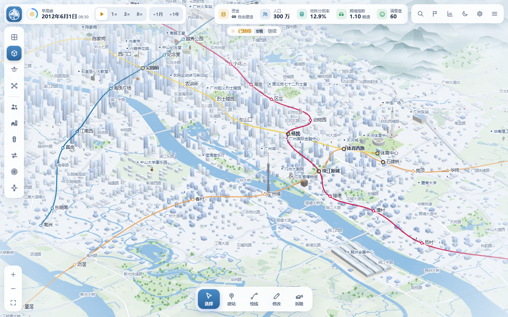
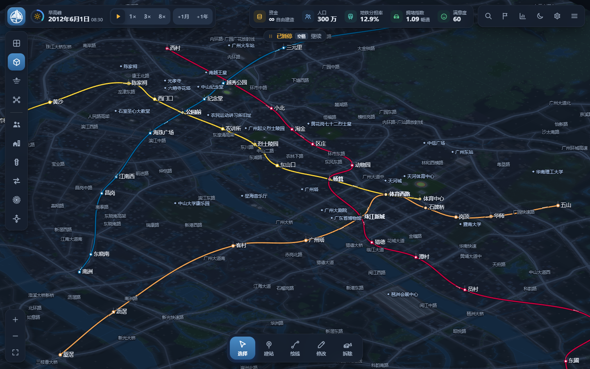
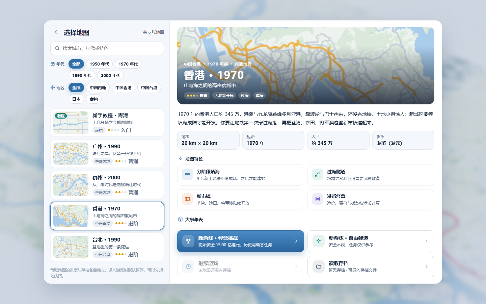

# 城市与地铁

**在真实城市里，画出你自己的地铁。**

从第一座车站开始，连接住区与商圈，跨过江河、穿行地下，逐步织出自己的交通网络。《城市与地铁》是一款打开浏览器就能玩的单人地铁规划与城市经营游戏：线路由你决定，城市会随时间发展，居民也会根据你的路网重新选择出行方式。

**[立即在线游玩](https://city-and-metro.pages.dev)** · [运行与存档](#运行) · [非商业使用许可](./LICENSE.txt)

- **五座真实城市，加一张独立教程地图。** 从广州、杭州、香港、台北的零地铁开局出发，或接管 1950 年东京的银座线；第一次玩，可以先到青湾学会规划。
- **自由建造，或接受经营挑战。** 放开资金限制专心设计，也可以在有限预算下平衡建设、票款与运营，发行债券为新线筹资。
- **从城市全景，看到地下线网。** 在 2D、2.5D 和地下视图间切换，跟随列车穿行，也能展开车站、线路与片区的细节。
- **让每一条线都有依据。** 观察人口、就业、拥堵、出行方向和车站客流，找到值得连接的地方，再用换乘和扩建改善网络。

### 珠江两岸，连成一张网

广州演示线网与 2.5D 城市场景：河流、街区、地标和地铁在同一张地图上呈现。



### 换个视角，看清地下

切换深色主题与地下视图，查看车站、隧道和换乘关系。



### 从熟悉的城市，开始新的规划

六张地图各有地理、年代和经营条件；在地图选择页了解特色，再决定这一局从哪里出发。



以上为当前版本实机画面，广州两幅截图使用游戏内的演示线网。

## 版权与许可

**Copyright © 2026 VinsonFung。保留所有权利，禁止商业使用。**

本项目仅允许非商业学习、研究与游玩，不提供商业使用授权。禁止将游戏代码或自有资源用于收费、广告变现、商业产品、商业服务或商业分发；修改、改名或免费提供均不构成商用例外。具体条款见 [LICENSE.txt](./LICENSE.txt)。OpenStreetMap 地理数据仍遵循 ODbL 1.0，详见 [第三方许可说明](./THIRD_PARTY_NOTICES.txt)。

本仓库公开供非商业学习、研究与游玩；公开代码不构成商业使用授权。自动部署流程见 [部署说明](./部署说明.md)。

## 版本与文档

当前游戏版本为 **v1.7.0**，需求与实现基线见 [PRD V1.6](./PRD.md)，地图规范见 [地图设计指南 V1.5](./地图设计指南.md)。各版本的更新内容可在游戏主菜单右上角的「更新公告」中查看。这是一款单人网页模拟经营游戏，可选择广州、杭州、香港、台北、东京五座真实城市，以及虚构教程小城青湾。真实城市采用 OpenStreetMap 地理骨架，并结合年代、城市发展及历史地形规则；东京开局接管既有地铁。发布状态及验证范围见[部署说明](./部署说明.md)。

**v1.7.0 已上线**，包含台北、债券融资、最新交互修复及六图性能优化；本地测试与线上部署验证分别记录在[部署说明](./部署说明.md)。

## 运行

双击 `index.html`，用桌面版 Chrome / Edge / Firefox 打开即可。纯 HTML/CSS/JS，无需安装、无需构建，也不需要本地服务器。

进度保存在浏览器本地（IndexedDB，不可用时退回 localStorage），无需账号；更换电脑请用「读取存档」中的导出 / 导入。存档列表中的「重命名」直接展开名称输入框，可保存或取消；Enter 保存、Esc 取消，不使用浏览器弹窗。

## 开始界面

左侧为标题与四个入口：**开始游戏**（进入地图选择）、**继续游戏**（所有地图中最近的存档，并标明地图；无存档时不可用）、**设置**、**退出**，下方另有「新手教程 · 青湾」的快捷入口。读取存档与导入存档文件在地图选择页中（每张地图各自的存档），主菜单不再重复。右上角是一组同样式的按钮：**更新公告**（查看每个版本的更新内容，有新版本时显示红点）与浅色 / 深色切换。

**动态背景**：2.5D 广州，镜头沿一条环形路线缓慢巡游珠江新城、广州塔、海珠、沙面、公园前、东山与天河体育中心（位置与缩放平滑过渡，焦点在菜单右侧）；示意地铁线上有列车按班次往返、停站，道路上有汽车行驶。开始界面先出现，背景城市随后淡入。实际绘制耗时随设备、浏览器和画面规模变化。

**返回主菜单**：从任意地图返回时，背景切回广州，并清掉游戏中的视图状态（分析图层、选中与高亮、建设工具、相机飞行、地下视图、跟随列车、教程卡片与特效），背景照常显示建筑、线路与列车，不会因图层等残留而出错。

### 地图选择

「开始游戏」后先选择地图。界面左侧是地图的预览与选择：搜索栏（城市名、年代、特色关键词均可）、按**年代**与**国家和地区**筛选的标签，以及按难度由低到高排列的地图列表（青湾教程 → 广州 → 杭州 → 香港 → 台北 → 东京；同难度保持原城市顺序，新增地图自动参与排序）。缩略图按真实数据绘制，显示一句话特色、地区、难度与已有进度；↑↓ 键按此顺序切换地图，Enter 开始。右侧是选中地图的详情：大幅预览与标题、重新撰写的介绍、范围 / 起始 / 人口 / 货币等要点、四项**地图特色**与**大事年表**，底部是该地图自己的操作：

- **新游戏**：广州、杭州、香港、台北、东京均可选「经营挑战」或「自由建造」；青湾为「开始教程」。
- **继续**：该地图最近的存档。
- **读取存档**：只列出这张地图的进度，也可在这里导入存档文件（没有存档时同样可进入；从这里返回会回到地图选择）。游戏中的菜单仍可「读取存档」，列出全部地图的进度。

每张地图的进度分别保存和筛选；存档记录所属地图，载入时自动切换。兼容格式 v2 且没有地图标识的旧存档默认广州；v1 旧版示意地图存档仍不支持。

| 地图 | 说明 |
| --- | --- |
| 广州 · 1990 | 真实地理，30 km × 24 km，约 300 万人；经营挑战 / 自由建造；历史参考任务与动态任务 |
| 杭州 · 2000 | 28 km × 22 km，约 300 万人；无地铁开局；西湖、运河、钱塘江两岸及新区发展；人民币 CNY |
| 香港 · 1970 | 20 km × 20 km，约 345 万人；无地铁开局；山地、海港、新市镇与分阶段填海；港币 HKD |
| 台北 · 1990 | 26 km × 22 km，盆地内约 500 万人；无捷运开局，历史在建工程不预先生成；淡水河、新店溪、基隆河分隔盆地，阳明山与周边山地不可开发，松山机场不开放建设；基隆河截弯取直新生地 1994 年、新板特区 1999 年开放；新台币 TWD |
| 东京 · 1950 | 24 km × 22 km，约 540 万人；预置浅草—涩谷银座线 18 站，免费接管且正常产生运营费与票款；东京湾分阶段填海；日元 JPY |
| 新手教程 · 青湾 | 虚构小城，12 km × 10 km，2000 年起约 42 万人；青江穿城而过（两座跨江大桥、环城快速路、火车站、凤凰山风景区）；老城、西关、东关、北站、东部工业区、南岸新区开局开放，科技园 2003 年、外围地区 2008 年开放；自由建造，不出动态任务 |

人口是地图范围内的模拟开局目标，不等同于行政区统计。真实城市各有历史主题任务（台北 9 项，其余 7 项）及本局动态任务，台北另有 4 项按年份出现的本城动态任务；任务不要求复刻真实地铁线路，年份推进也不会自动建设后来开通的现实地铁。普通铁路继续仅作背景，不参与乘车模拟或玩家经营。

**经营参数**按城市和年代配置，金额内部单位为“万 + 本城货币”。以下为当前游戏平衡值，不是历史票价或工程造价：

| 地图 | 票价默认值 | 滑块范围 / 步长 | 经营基础开局资金（首月拨款另计） |
| --- | --- | --- | --- |
| 广州 | 2 元 | 0～10 / 0.5 元 | 30 亿元 |
| 杭州 | 3 元 | 0～10 / 0.5 元 | 50 亿元 |
| 香港 | 0.5 港元 | 0～5 / 0.1 港元 | 15 亿港元 |
| 台北 | 20 新台币 | 0～80 / 5 新台币 | 160 亿新台币 |
| 东京 | 10 日元 | 0～300 / 5 日元 | 100 亿日元 |

**历史海岸线**：香港配置 9 组、东京配置 12 组填海多边形，在设定年份以前按水域处理，系统成陆后才逐步开发。范围和年份是对历史的近似，不能理解为完整重建。保存后按存档年份恢复地形，填海和历史事件也可进入城市里程碑。

### 经营挑战的财政与债券

经营挑战保留每月政府拨款、票款、建设费用、运营成本和原有失败规则，另可发行两种债券为建设筹资（自由建造资金无限，不使用债券）：

- **地方债**利率较低、额度较大；**城投债**利率 = 地方债 + 利差，额度较小。利率按城市与发行年份设定并在发行时固定，期限 3 年或 6 年（6 年期略高）。年度发行额度与总债务上限按当年基础月拨款的倍数计算，随城市与年代变化。
- 募集资金进入**建设专项资金**，只能用于地铁建设与改扩建（建设时优先动用），不算财政收入，不能支付运营成本或利息。每年发行周年付息、到期一次还本，均从一般资金支付。
- 一般资金不足时，差额记为**逾期**（不会因单次违约失败）：逾期每月加收 1%（满 6 个月 1.5%、满 12 个月 2%）的额外费用，有逾期时暂停城投债，逾期满 6 个月暂停全部发债；一般资金恢复后自动按费用 → 利息 → 本金清偿。
- 财政页分为收支明细（财政收入、融资到账、建设支出、运营成本、利息、本金分列）、债券融资、债务详情与未来偿债预测、资金流水。结算按月去重，补齐已到期的遗漏期次；v1.6 及更早没有债务字段的旧档按零债恢复，v1.7 档保留专项及债务。
- 打开发行页先暂停，结算 / 跳跃期间不能发行，保证预览与实际利率、额度及日期一致；成功发债触发自动保存。到期欠本继续占用额度，小额逾期保留，实付利息与未付款分开，只有本息清偿才标为还清。专项足额时，一般余额为负仍可建设。

### 开局简报

新开存档（教程除外）时先显示这座城市当时的交通格局：地铁、公交与自行车、渡轮或电车、过江或过海方式与铁路，以及你的起点（模式、资金、人口、已开放区域、票价）与首批任务。东京开局在最上方明确提示「你接管了银座线」，并显示车站数、里程与日客运量。关闭后游戏保持暂停并打开任务面板；之后可在日期面板或游戏菜单中再次查看（此时显示当前情况）。

### 新手教程

青湾地图以 12 个循序渐进的引导任务介绍游戏（另有开场与结束页）：移动地图 → 人口密度图层 → 在钟楼建第一座车站 → 从钟楼画线到青湾火车站 → 确认建设 → 让时间运行 3 小时 → 查看车站或线路详情 → 跨过青江在南岸设站 → 建一座换乘站 → 打开道路拥堵或出行方向图层 → 跟随一列列车 → 打开线路示意图。

- 左上角的引导卡片显示目标、操作说明与提示，以及任务进度条；完成后自动打勾并进入下一步，也可「跳过」「上一步」或收起卡片（图层图例自动排在卡片下方）。
- 需要点的按钮会闪烁提示；需要去的地方在地图上用虚线圈或区域范围高亮（例如钟楼与青湾站、南岸新区）。
- 最后一个引导任务之后有一页可跳过的「经营挑战的财政」小知识（拨款、票款、运营成本、地方债与城投债、专项资金与逾期），只做说明、不实际发行债券，可在「菜单 → 操作说明」中回看。
- 教程进度随存档保存，可随时退出、之后从地图选择页「继续教程」；完成后可继续在青湾自由建设，或一键返回地图选择开始广州。

## 界面布局

| 位置 | 内容 |
| --- | --- |
| 左上 | 游戏标志、日期与一天进度、速度（暂停/继续 · 1× · 3× · 8×）、+1月 · +1年 |
| 右上 | 关键指标（资金、人口、地铁分担率、拥堵、满意度，窄窗口按优先级收起）；搜索、任务、统计、主题、设置及菜单；桌面设置在齿轮入口，窄屏设置与主题移入菜单 |
| 左侧 | 视图（2D / 2.5D / 地下 / 线路示意图）；6 个分析图层按钮（人口密度、住宅与就业、道路拥堵、出行方向、地铁覆盖、车站客流），点击开启、再点关闭，开启时按钮显示该图层颜色 |
| 左下 | 放大、缩小、全图 |
| 底部 | 建设工具（选择、建站、绘线、修改、拆除）；上方为当前工具的选项条（线路、建设方式、新站规模或操作提示）与草案栏（修改数、费用、冲突、撤销重做、放弃、确认建设，点击「草案」看详情） |
| 右侧 | 详情面板（车站、线路、道路、片区、指标、财政、任务等） |

**浅色 / 深色**：顶栏右侧与开始界面右上角的 ☾ / ☀ 按钮（或 N 键）直接切换，画面平滑过渡。

**游戏菜单**（右上 ☰）：保存进度、读取存档，开局简报、城市纪事、操作说明、更新公告，返回主菜单。

**统一的交互与反馈**：所有按钮、卡片、列表项、标签页与筛选标签使用一致的悬停（背景变化或轻微上浮）、按压（缩小回弹与涟漪）、点击音效（切换标签与筛选为更轻的音效）和键盘焦点环；窗口统一圆角与标题栏样式，内容切换只做轻微淡入。没有快捷键的按钮，悬停提示只显示说明。

**手机与平板**（宽度 ≤ 760 px）：顶栏分两行（日期与速度；资金与搜索、任务、统计、菜单，深浅模式与设置移入菜单）；左侧视图与图层坞缩小；详情面板改为底部抽屉；统计、线路示意图全屏；选择地图改为上方横向列表、下方详情。地图与线路示意图支持单指拖动、双指缩放；触屏不显示悬停提示，缩放按钮只保留「全图」。

## 操作

| 操作 | 方式 |
| --- | --- |
| 平移 / 缩放 | 左键拖动、WASD / 方向键；滚轮、+ − |
| 工具 | V 选择 · B 建站 · L 绘线 · E 修改 · X 拆除 |
| 绘线 | 依次点击车站或空地；起点自动决定线路：点线路端点即延长该线路，点空地或中间站则开始新线路（选项条上可改为新线路或支线）；Shift+点击加转弯点；点首站成环线；右键 / Enter / 再点终点结束 |
| 延长 | 选中线路后拖动端点的「+」手柄，松开处新建车站并连线；车站详情中可「延长 X 号线」或从中间站「绘制支线」 |
| 多选 | 选择 / 修改工具下按住 Ctrl 或 Shift 点击多座车站或多段轨道，在「批量修改」中统一升级或改建 |
| 草案 | Ctrl+Z 撤销，Ctrl+Y 或 Ctrl+Shift+Z 重做（草案栏按钮相同）；Ctrl+Enter 或「确认建设」提交；「放弃」不产生费用 |
| 时间 | 进入游戏默认暂停；空格暂停/继续，1–3 切换 1×/3×/8×；+1月 结束后只显示简短消息，+1年 显示变化摘要 |
| 视图 | T 切换 2D / 2.5D，U 地下视图，K 线路示意图，F 全图 |
| 跟随列车 | 选择工具下点击行驶中的列车（悬停有提示）；H 隐藏 / 显示界面，Esc 或拖动地图退出 |
| 界面 | / 搜索（车站、线路、道路、区域、地标、地名），G 统计面板，N 浅色/深色，M 音效，Esc 关闭面板或清除地图上的定位高亮（在设置滑块上同样有效） |

新车站会自动采用附近真实的地铁站名或地名（如西门口、公园前、体育西路）。

## 规划与经营工具

- **票价**：每个进度全网统一票价，财政页用一个滑块调整，金额、币种、范围及步长随城市变化，详见上表；拖动时更新金额与影响估算，松手后重新计算客流。展开可看当前票务收入、按新票价估算的收入和满意度影响。
- **车站规模卡片**：小型 / 中型 / 大型三张卡片，直接显示容量、编组上限、建设费和日运营费；既有车站升级时显示升级前后的差异和本次升级费用。
- **拥挤诊断**：车站详情区分「车站容量不足」与「列车运力不足」。前者可直接升级车站；后者说明瓶颈区间、发车是否已达上限，以及限制编组的车站（只升级本站往往无效），并提供「定位瓶颈区间」「加长编组」「查看可分流方向」。
- **搜索与收藏**：按名称搜索车站、线路、道路（已建成的有名道路）、区域（含括号里的街道名，如搜「石牌」可找到天河西）、城区、地标和地名，回车或点击即定位。车站、线路打开详情；道路、区域、地标、地名在地图上闪烁高亮约 7 秒并标出名称（道路沿全线发光，区域按真实边界描边填色）。车站、线路详情中的 ☆ 可收藏（收藏随存档保存，改名自动同步，已拆除的会注明）。
- **定位高亮**：任务中的「定位片区」「定位地点」、片区详情的「定位」、开放区域列表等，都会飞到目标并用动画虚线框、半透明填色和名称标签标出范围，不再只是移动镜头；Esc 可提前清除。
- **批量修改**：多选车站统一升级（只升级、不缩减）或多选轨道统一改为地下 / 地面 / 高架，先显示本次费用、草案合计与新增冲突，再作为一步加入草案（可一次撤销）。
- **拆除预览**：拆除工具悬停时，地图上标出实际变化（红色为拆除，彩色虚线为两侧轨道直连保留，灰圈为失去服务的车站，橙圈为不再换乘），提示中列出环线断开、支线取消、换乘消失等影响。
- **线路示意图**：默认「地理线网」，车站中心、实际轨道曲线和地形共用等比例地理坐标，保留河岸两侧、真实跨河与绕行关系。水系、湖泊、海岸、岛屿和山林直接使用游戏地图几何，小水面不会因面积小而省略；历史未填海土地按当前年份显示为水面。完全共线的区间用同心色带区分，聚焦线路时显示在最上层。工具栏可切换为「简洁示意」，以 0° / 45° / 90° 布局突出连接与换乘关系；该模式不显示地形。地下为实线、高架带白色中线、地面带白色枕木纹；换乘站保留多线彩环与 ⇄，站外虚线只表示换乘联系。站名避让实际线路、车站及其他站名；缩放逐帧缓动，山形按钮开关地形时保留当前视野。支持聚焦、草案预览、点击定位及两种布局的完整 PNG 导出。
- **导出线路图 PNG**：右上角「导出 PNG」导出完整网络，不受当前缩放与聚焦影响；包含游戏时间、线路 / 站数、图例和说明。地理模式标题及文件名使用「地铁地理线网图」，简洁模式使用「地铁线路示意图」。通常为 2 倍分辨率，大图按尺寸上限缩放；完整共线色带不随屏幕聚焦顺序变化。
- **列车跟随**：选择工具点击可见列车，镜头平滑跟随并放大，被跟随的列车带脉动圆环。底部卡片显示线路与方向（开往某站 / 环线顺逆行）、当前状态（驶向某站、停靠某站、等候发车、跨江桥梁或江底隧道）、到下一站距离、速度、地下 / 地面 / 高架与满载率；可切换同一线路的上一列 / 下一列。自动地下视图可关闭，正常退出按相应状态恢复。按 H 隐藏主要 HUD，保留精简跟随信息；Esc、拖动地图或键盘平移退出。
- **自动配车**：系统按线路最低服务水平与最大断面客流需求（目标满载率 85%）中较高者调度。最低服务水平随站数、平均站距和时段调整，非环线还按周转时间提高基础班次，以尽量保障两列在线；仍受最高 30 列/小时（最短 2 分钟间隔）约束，不保证任意线路至少两列或夜间运营。线路详情显示当前发车、运行列车、全日配属列车及配车依据。
- **存档**：「已保存」标注对应的游戏时间；运行中的进度（含日内时间）会标为未保存，暂停时自动保存；返回主菜单前先保存最新状态，失败时不会离开当前游戏。

## 真实地图

- **数据**：珠江水系与湖泊、主要道路与支路、桥梁与隧道、铁路、公园与山林、区与街道边界、地名，以及各地标的真实场地位置，均来自 OpenStreetMap（© OpenStreetMap 贡献者，ODbL），按 250 m 网格投影，已预处理在 `js/geo_gz.js` 中（约 1 MB）。
- **历史年代**：主要道路与桥梁按参考通车年份出现（如珠江隧道 1993、广园快速 1997、内环路 2000、猎德大桥 2009）；其余道路随所在区域开放出现；支路只在已开发的街区显示，城市生长时逐步出现。
- **区域开放**：由真实街道边界组合而成（如珠江新城 = 冼村 + 猎德街道，1993 年开放；大学城 = 小谷围街道，2004 年开放）。
- **建筑**：街区建筑布置在 4×4 子地块上，避开真实道路、铁路与水面；每格只放少量简化体块（低层小楼、商务区 1–2 栋玻璃塔楼），按开发强度增减。
- **地标**：按真实场地大小与朝向建模，共 33 处，包括中山纪念堂、镇海楼、六榕寺花塔、光塔、石室圣心大教堂、沙面（含白天鹅宾馆）、越秀山体育场、天河体育中心、广州火车站、广州东站、中信广场、琶洲会展中心、广州塔、西塔、东塔、广州大剧院、广东省博物馆等，按落成年份出现。广州塔按实际外观：白天为灰色钢结构双曲面网格外筒（中灰立柱与斜撑、深灰圆环、深灰核心筒，收腰约在 280 m 处）和灰色天线桅杆（顶部红色航空障碍灯），深色主题下为内嵌 LED 的粉—紫—蓝彩色灯光。大学校园为受保护的校园片区（内部校舍照常生成），可在校园内设站。其他城市的地标同样按落成年份出现，例如杭州的雷峰塔（2002）与杭州东站（2013）、香港的中银大厦（1990）、东京的东京塔（1958，国际橙与白色相间的钢桁架）与东京晴空塔（2012，三角形底座渐变为圆形的白色桁架）；超高层模型按各自高度与占地等比缩放。

## 地图风格与性能

- **清新微缩风格**：浅蓝白底色、柔和蓝色珠江、浅绿公园；白色道路；建筑为稀疏的蓝灰玻璃体块（高楼有渐变与高光）；白云山等山地画成青绿色水墨山峰，山脚带雾；地图边缘有雾化，2.5D 远景有薄雾（不再有飘云等装饰效果）。
- **线路颜色**：按地图配置。广州新建第 N 条线路参考广州地铁 N 号线配色：1 号线黄、2 号线蓝、3 号线橙、4 号线绿、5 号线红、6 号线紫红、7 号线浅绿、8 号线青、9 号线薄荷绿、13 号线橄榄、14 号线棕红、18 号线深蓝、21 号线深紫、22 号线橙红（色值为近似；10–12、15–17、19、20 号线在游戏中自拟）。青湾使用独立配色；已有存档里的线路颜色不变，可在线路详情中改色。
- **地铁**：彩色线路、白色车站。**换乘站**有专门的换乘标志：更大的车站圆、深色外环、按各线路颜色分段的内环，放大后中间显示 ⇄ 换乘箭头；站外步行换乘的两站之间画虚线并同样标为换乘站。地下视图中地面变淡、线路突出。
- **分析图层**：开启时隐藏建筑与车辆，只突出图层内容。
  - 人口密度、住宅与就业、地铁覆盖为浅色半透明着色（最高约 50%），道路、河流和地名仍清楚可见。
  - 道路拥堵只显示主要道路（快速路与主干道，匝道不画），沿真实道路线形连续着色；按当前时刻的饱和度（流量 ÷ 通行能力）分畅通 / 缓行 / 拥堵 / 严重拥堵 4 档：已建成的干道全部着色、车少时为绿色（不再有与底图难以区分的「空闲」浅灰档），随早晚高峰实时变化，线越粗道路等级越高。
  - 出行方向按开放城市片区汇总（广州老城再分越秀、东山、荔湾），每片区显示主要方向及达到首方向 60% 的第二方向，取消固定 10 条上限，过滤极小流量及画面距离过短的关系。互为主要方向时合并为双向箭头，蓝色部分为地铁比例。箭头按流量优先避让，必要时缩短、偏转或省略目的地名称；流向数据、时段、缩放档位、视角或窗口大小变化时更新，平移不反复排版，变化平滑过渡。
  - 车站客流用典型工作日全天数据（夜间停运时也能看）：圆越大客流越大，颜色为高峰小时负荷，线路下方色带为区间断面客流，并标出站名与日客流。
- **深色主题**：同一套地图换成深蓝夜景，建筑亮灯。
- **自动渲染**：按视野裁剪地形、建筑、轨道与动态对象，道路动画使用空间索引；负载持续升高时自动降低中远景缓存细节及代表性汽车细节，负载下降后恢复。近景、地标、站点、轨道、文字与跟随列车保持必要表现，不增加手动画质页。建筑缓存分帧生成，完成后替换，地理路径、标签与分析图层按相关变化复用；已完成图块采用 2400 万像素 LRU 预算，切图释放旧城市及生成任务。汽车 / 行人上限仍为 320 / 180，不代表模拟需求上限。
- **模拟效率**：复用独立的实时 / 预测缓冲、精确步行树和相同道路拓扑，减少重复路径计算与线路距离累计。实时求解只在数值完全相同的固定点暂停重复工作，输入变化即唤醒；显式求解次数、交通模型、自动配车及结算规则保持。拥堵图层继续按视野缓存，拥堵变化最多每 0.4 秒更新。
- **验证**：六图初始 / 40 / 160 / 400 站、累计 143 个游戏年及旧档对照通过；优化实现与测试摘要见 [PRD 第 17.7 节](./PRD.md#177-六图性能优化与稳定性)和[部署说明](./部署说明.md)。本机隔离浏览器的测试不能外推为所有设备的性能保证。

## 线路规则（更接近真实地铁）

- **车站为直线站台**：车站两侧各约 70 m 为直线，线路平顺（切线连续）地穿过车站。
- **转弯半径**：小于 250 m 为冲突（无法建设），250–400 m 提示限速；弯道过急时可加转弯点让曲线更平缓。
- **车站处转向**：同一线路在车站前后的方向变化不能超过 60°。
- **坡度**：地下 / 地面 / 高架之间的坡道按 3% 坡度计算长度，区间过短放不下坡道时报冲突。
- **平交**：两条地面线路不能平面交叉，需改为地下或高架。
- 检查只针对本次草案改动的区段与车站（及同线相邻区段），不会因旧线路而阻止新建设。
- **移站同样受约束**：车站移动或改变建设方式后，始终检查选址、站距（≥ 350 m）与保护建筑，与是否收费无关；免费微调按上次付费选址累计计算，多次小幅移动累计超过 250 m 按搬迁收费。
- **未通车的车站不提供服务**：未接入线路的车站不计入地铁覆盖、不产生客流与票款；只靠站外步行连接、没有实际乘车段的路径不算地铁出行。

**冲突提示**：草案面板按编号列出每处冲突，并说明「怎么解决」；地图上对应位置有红色编号图钉、相关轨道或车站红色高亮；悬停列表项会放大地图图钉，「定位」飞到冲突处，并提供一键修复。草案栏的冲突徽标可直接跳到第一处冲突。

## 反馈与动画

- 建站时地图上出现涟漪；铺轨时线路沿轨道描出；拆除时扬起烟尘；新线开通时车站绽放光柱与粒子，并弹出带彩带的开通横幅；新区域开放时在区域中心显示提示；任务完成有庆祝横幅。
- 资金变化（拨款、建设扣费）在资金旁飘出金额并短暂高亮；资金与人口数字平滑滚动。
- 按钮按压有涟漪与回弹；当前建设工具有滑动高亮；暂停时顶部显示「已暂停」提示；消息可点击关闭并显示剩余时间；所有按钮悬停显示说明与快捷键。
- 系统开启「减少动态效果」时，界面动画自动缩短。

## 统计面板

右上图表按钮或 G 键打开，分「概览 · 交通 · 财政 · 城市纪事」四页（财政仅经营挑战，自由建造为三页）。标签页之间以滑动指示块切换，切换或每日刷新只替换内容区并同步绘制图表，窗口不会重播入场动画或闪动。概览为 6 个指标卡、地铁客运量趋势和各线客流；交通为分担率、覆盖率、拥堵、通勤及高客流站；财政为资金、收入与支出，超过 36 个月按年汇总。图表可悬停读值。

**城市纪事**（里程碑）以书页形式记录地铁建设、客流、城市发展及历史事件的关键节点：每页一个里程碑，有日期、类别、标题、说明和一幅按事件类型绘制的简笔画（首条线路、换乘、跨江、环线、人口、客流、地标、填海、历史事件等）；宽屏两页一开、窄屏单页，可用两侧按钮、← → 键或左右轻扫翻页。下方时间轴按顺序排列每个里程碑（年份变化处标年份），当前页高亮，点击即跳到对应页；可按类别筛选，最后一页「未完待续」列出人口、里程、日客流和分担率的下一个目标。东京开局单独记录“接管既有地铁”，开局时银座线已达到的客流门槛不再重复记为里程碑；旧存档只补记能够从月度历史或当前网络推断的节点。日期详情改为里程碑入口及数据来源说明，不再重复展示全部区域开放列表和逐条发展记录。里程碑随存档保存，不等于完整事件日志。

## 目录结构

```
index.html            入口（双击打开）
img/                  游戏标志（白色版、深蓝版）与网页图标
css/style.css         界面样式（浅色 / 深色主题、界面大小、动画）
js/util.js            数学、随机数、堆、折线几何、格式化、编码
js/config.js          全部可调参数与当前默认值
js/news.js            更新公告（每个版本的更新内容）
js/geo_gz.js          真实地理数据（OpenStreetMap 预处理结果：水系、道路、铁路、绿地、行政区、地名）
js/geo_hz.js          杭州 OpenStreetMap 预处理地理
js/geo_hk.js          香港 OpenStreetMap 预处理地理
js/geo_tk.js          东京 OpenStreetMap 预处理地理，运行名称转为简体中文
js/geo_tp.js          台北 OpenStreetMap 预处理地理，名称转为简体中文
js/geo.js             地理数据解码、栅格化（水域距离场、覆盖率）与空间索引
js/data_gz.js         广州场景规则：区域与开放年份、道路通车年份、地标、人口中心、事件、历史参考任务、线路配色
js/data_tutorial.js   新手教程地图「青湾」：虚构地理（与 geo_gz.js 同格式，运行时生成）与城市规则
js/data_hz.js         杭州场景、任务、历史参考与人民币经营参数
js/data_hk.js         香港场景、填海阶段、任务与港币经营参数
js/data_tk.js         东京场景、银座线初始网络、填海、任务与日元经营参数
js/data_tp.js         台北场景、新生地与新区、历史与本城动态任务、新台币经营参数
js/maps.js            六图登记与切换、经济和年代配置、地图版本 / 场景 / 诊断指纹、缩略图
js/city.js            城市：真实地形与区域、土地利用、人口就业、道路格网与真实道路、步行图与汽车路网、月度发展
js/metro.js           地铁网络：编辑操作、曲线几何、线路形态（普通/环线/支线）、冲突检查、费用
js/sim.js             交通模拟：重力模型需求、沿道路步行接驳、地铁路径与候车换乘拥挤、Logit 方式选择、
                      道路分配（BPR + MSA）、自动运力调整、建设前预测（时间切片执行）
js/economy.js         财政、票价、拨款、债券与逾期、资金流水、满意度、失败判定；历史参考任务与动态任务
js/game.js            时钟、日/月结算、跳月跳年、草案与确认、存档序列化
js/save.js            多进度、自动/手动存档、导入导出与校验
js/render.js          相机与视图过渡、真实地图绘制、等距建筑与地标精灵缓存、分析图层、地铁、反馈特效、标注
js/agents.js          列车、汽车（沿真实道路行驶，夜间车灯）、行人
js/icons.js           界面 SVG 图标
js/settings.js        设置（保存与即时生效）
js/sound.js           音效（Web Audio 实时合成，无音频文件）
js/tools.js           地图交互与建设工具、冲突图钉与高亮
js/ui.js              顶栏、视图与图层坞、详情面板、草案栏与冲突列表、菜单、设置与存档界面
js/screens.js         全屏界面：开始界面、选择地图（搜索与筛选）、开局简报、更新公告
js/pages.js           详情页：车站、线路、道路、片区、指标、日期、财政、任务、存档、帮助
js/stats.js           统计面板（指标卡与 SVG 图表）与城市纪事（书页、简笔画、时间轴）
js/milestones.js      城市里程碑、分类、后续目标及旧档补记
js/netmap.js          准确地理线网 / 八方向简洁示意、真实轨道与地形、换乘支线、缩放定位及 PNG
js/follow.js          列车跟随模式（镜头跟随、运行信息卡片、自动地下视图、隐藏界面）
js/tutorial.js        新手教程引导（步骤、完成检测、按钮与地图高亮）
```

## PRD 覆盖说明

| 范围 | 实现要点 |
| --- | --- |
| CITY-01～03 | 1990 年开局，仅开放主要建成区；按真实街道边界组成的 27 个区域按参考年份开放，人口达到阈值可提前开放；真实道路与桥梁按通车年份出现，街区开发后显示真实支路；地铁可达性影响人口与就业增长；2020 年后为模拟发展（界面标注）；无结束年份 |
| VIEW-01～05 | 2D / 2.5D 微缩城市、地下视图、汽车 / 列车 / 行人、平滑过渡与分块缓存；列车跟随、自动地下视图与隐藏主要界面 |
| BUILD-01～06 | 自由选址与曲线绘线；普通线路、环线、支线均可运营与寻路；地下/地面/高架，跨江分别为隧道/桥梁；保护建筑与山地、未开放区域冲突阻止提交；普通建筑按开发强度计拆迁费；小/中/大型车站；车站移动、线形调整、升级、改建、拆除；小范围调整免费；确认即建成 |
| SIM-01～04 | 小区出行需求分早高峰/平峰/晚高峰/夜间；沿道路计算步行覆盖与站外换乘（真实河道阻隔）；方式选择综合接驳、候车、换乘、拥挤、票价与汽车耗时；地铁吸引改变道路流量，拥堵按 BPR 变化 |
| OPS-01～02 | 按站数、站距、周转时间及客流自动配车，受最大发车频率约束；全网统一票价滑块；运营费按车厢公里与车站规模计算 |
| MODE-01～04 | 自由建造与经营挑战；原四城各 7、台北 9 项历史任务，台北另有 4 个本地动态模板；地方债 / 城投债、专项资金与逾期 |
| DATA-01～06 | 6 个分析图层、建设前预测、统计纪事、准确地理线网 / 简洁示意及两模式 PNG |
| TIME-01～02 | 进入游戏默认暂停；3 档速度；跳月 / 跳年逐日结算，月跳消息、年跳摘要 |
| SAVE-01～05 | 本地自动 / 手动存档、地图身份、内联改名及新名加载 / 导出；坏档拒绝，旧保存不覆盖新名 |
| MAP-01～16、TUT-01～04 | 六图选择与各图进度；各城独立开局、货币及经营；历史填海、东京初始网络；青湾独立教程 |
| UI-01～11 | 鼠标键盘、地图概览及可展开详情、草案与设置；按难度选图、搜索筛选、简报 / 公告、触屏和可滚动窄屏菜单 |

## 当前默认参数

以下为广州样本默认值，集中在 `js/config.js`；其他城市在各自数据文件覆盖，不能将这些值视为六图通用参数：

- 地图 30 km × 24 km（250 m 网格，东经 113.20°–113.49°、北纬 23.00°–23.215°），交通小区 1 km²；1× 速度下一天约 60 秒
- 最小站距 350 m；步行接驳上限 15 分钟（1125 m）；站外换乘步行上限 500 m
- 建设造价表（地下 3 亿/km、高架 1.2 亿/km、地面 0.6 亿/km，越江与山体附加），年涨幅 3.5%
- 免费调整阈值：车站距上次付费选址 ≤250 m、轨道相对上次付费长度累计增长 ≤300 m；等长改线可确认。拆除动作无费用、无退款，混合形式区间合并产生的改建另计费
- 车站容量（小 9000 / 中 20000 / 大 40000 人次/时）与编组（4/6/8 节）
- 默认票价：全网统一 2 元/次，可调范围 0–10 元、步长 0.5 元；换乘不另收费（旧存档的里程票价按起步价换算）
- 月度结算：上月封账后，新月先处理任务及拨款，再偿还逾期与到期本息；一般与专项账户分别保持上月期末 = 下月期初，未付款不记为实付费用
- 经营挑战：初始 30 亿元；连续 24 个月负余额或低于负债下限（−20 亿元，随通胀）失败；满意度连续 12 个月低于 25 失败；失败后可转为自由建造继续
- 暂停期间允许建设、预测和调整票价

## 已知限制

- 地理位置来自 OpenStreetMap 的当前数据；1990 年的街道格局以「当前道路 + 通车年份 + 街区开发」近似，人口与就业为估算，不代表真实规划数据。
- 交通模拟在 250 m 道路格网上进行（快速路与主干道沿真实道路走向映射到格网），只模拟汽车与地铁两种方式，与 PRD 范围一致。
- 1.1 版起地图改为真实地理，1.0 版的存档无法载入（会给出提示），请开始新游戏。
- 桌面浏览器仍为主要使用环境；已加入手机 / 平板响应式布局、底部详情抽屉和触屏手势。浏览器触屏模拟不代表全部真机、大网络或所有建线操作已完整验收；窄屏与放大界面时会收起部分顶栏指标。
- 存档增加 mapVersion、scenario 和诊断指纹；缺版本旧档按地图第 1 版处理，未来版本及没有迁移函数的旧数据版本会拒绝。scenario 与指纹当前只记录、未强制校验，指纹也不是完整地理内容哈希；具体迁移方法须随地图升级提供。
- 真实地理仍为现代 OSM 骨架加年代规则；香港 / 东京仅重建已配置的填海范围，不代表逐年完整历史底图。地名已进行简体化处理，所有专名和史实仍需逐项核对。
- 台北的 1994 年新生地目前采用区域解锁，河道仍为现代 OSM 骨架，没有历史截弯取直几何序列；准确地理线网是与游戏地图保持一致，不等于完成历史底图或高程重建。
- 已加入切图清理和含城市实例 / 地形阶段的几何缓存键，六图已完成本轮长期状态及大网络性能对照；场景摘要见 PRD 第 17.7 节和部署说明，未来真实地图迁移及全部跨图边界仍须随变更验证。
